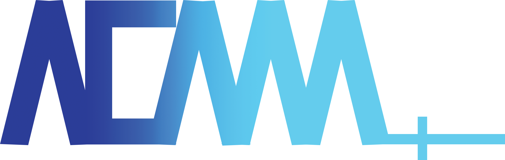

# 👋 欢迎来到 ACMM

  算法为刃，传承为火 —— 从这里开始你的程设竞赛之路

## Association of Connecting Miracle and Me（ACMM）

  

中山大学 ACMM 协会成立于 2008 年 9 月。社团宗旨为 “ACM More”，是中山大学推广 ACM 程序设计竞赛的第一社团。社团的全称为 “Association of Connecting Miracle and Me”。ACMM 协会担负着向校内推广 ACM 竞赛、普及算法思想的使命。ACMM 协会举办的比赛中，既有高水准和高挑战性的校赛，也包含了新手赛、月赛等面向初学者的普及性竞赛。

