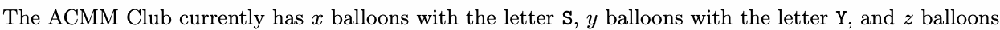
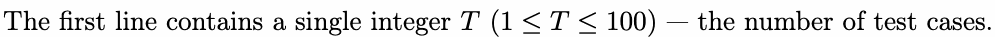
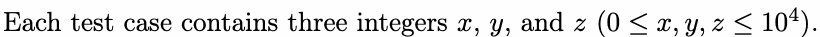

# A. Anniversary Celebration

Input file: standard input
Output file:

Output file: s s t t a a n n d d a a r r d d i o n u p t u p t ut
Time limit: 1 second

Time limit: s1tsaencdoanrdd

Memory limit: 512 megabytes

This year is the 100th anniversary of the founding of Sun Yat-sen University. To celebrate this great

moment, the ACMM Club plans to use balloons for decoration.



with the letter U. The staff can bxundle balloons with the foSuryletters of SYSU into a set Yand usez them for
decoration. What is the maximum number of sets bundled using the available balloons?

decoration. WhUat is the maximum number of sets bundled using the avaSiYlaSbUle balloons?

## Input





## Output

For each test case, output a single integer in a line — the maximum number of sets that can be bundled.

## Example

### 样例输入

```text
3
10 2 4
11 45 14
1924 100 2024
```

### 样例输出

```text
2
5
100
```

## Note

In the first test case, after bundling 2 sets of balloons, no balloon with the letter Y remains, and no new
bundle can be created.

bundle can be created.

In the second test case, after bundling 5 sets of balloons, only one balloon with the letter S remains, but
a new bundle requires two balloons with the letter .

a new bundle requires two balloons wit5h the letter S.
