# B. Bruhcaea Simulator

Input file: standard input
Output file:

Output file: s s t t a a n n d d a a r r d d i o n u p t u p t ut
Time limit: 3 seconds

Time limit: s3tsaencdoanrdds

Memory limit: 512 megabytes

As I always say,

if you don’t like it, don’t play.

— Guy, ©lowiro

A programmer named Baker is developing a simulator for an innovative 2D rhythm game called Bruhcaea.
There are lines displayed during the gameplay of , and any endpoint on the game chart can

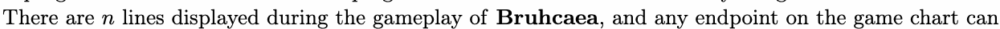

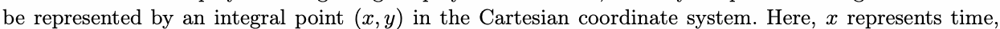

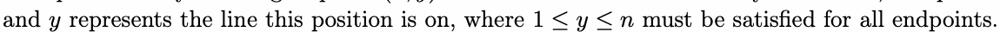

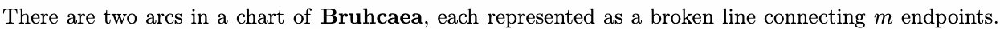

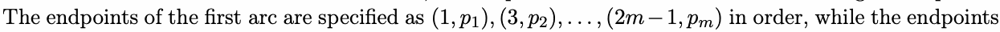

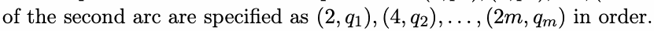

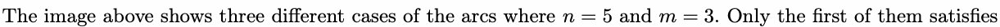

the following constrnai=nt5.

To maintain gameplay quality, the two arcs cannot intersect or touch at any position (not just at the
endpoints, as shown in the third case above). Furthermore, the more movements the arcs perform, the

endpoints, as shown in the third case above). Furthermore, the more amtoavenmyepntossitthieonarcs perform, the

more playful the chart becomes. Baker defines the playfulness of the two arcs as

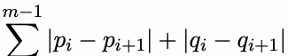

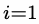

Baker is curious to know the sum of playfulness among all different configurations of arcs (i.e., distinct

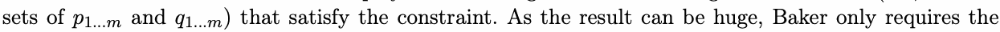

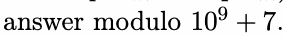

## Input

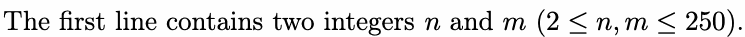

## Output

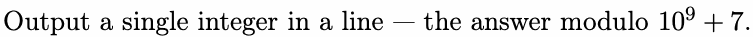

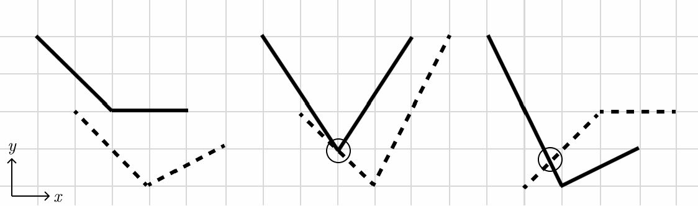

## Examples

### 样例输入

```text
2 2
```

### 样例输出

```text
8
```

### 样例输入

```text
5 3
```

### 样例输出

```text
19716
```

### 样例输入

```text
114 191
```

### 样例输出

```text
24045753
```

## Note

In the first example, there are 8 different configurations of arcs, as shown below.

Note: we rotated the coordinate system to display all the solutions better.

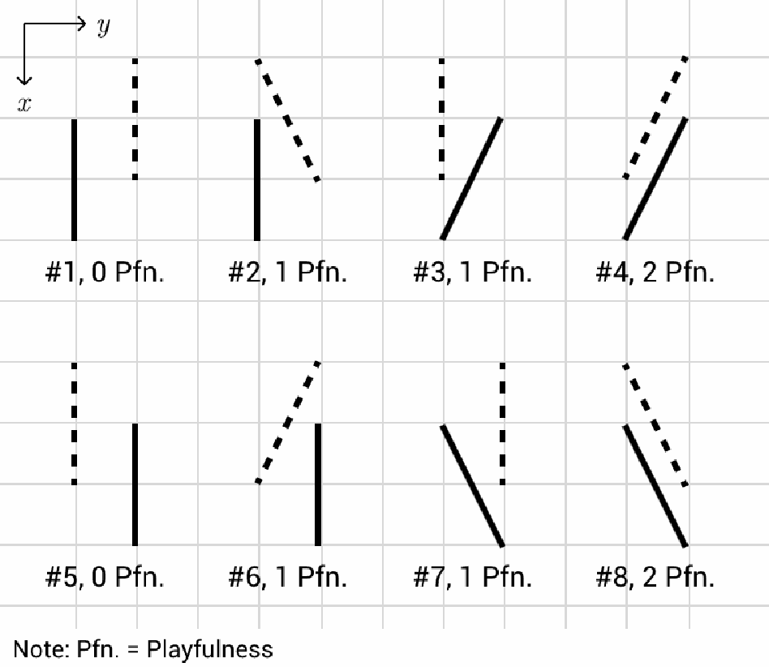
