# C. Contest Reactions

Input file: standard input
Output file:

Output file: s s t t a a n n d d a a r r d d i o n u p t u p t ut
Time limit: 1.5 seconds

Time limit: s1.t5ansedcaornddso

Memory limit: 512 megabytes

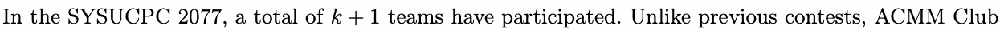

plans to generate contest reactionskba+se1d on the scoreboard. Your task here is to list the times when Team

0 solved new problems and to document the status of Team 0 when a problem is solved.

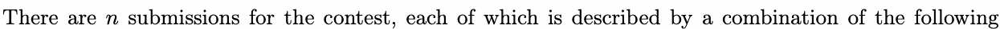

elements:

- Timestamp: this is displayed in the format hh:mm:ss.SSS, where hh, mm, ss, SSS represent hours,
minutes, seconds, and milliseconds, respectively.

mTiinmuetesst,asmecponds, and milliseconds, respectivehlhy:.

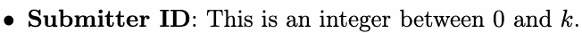

- Problem ID: This can be any uppercase letter, as there are exactly 26 problems in SYSUCPC
2077.

P20r7o7b.

- Result type: This can be either AC (Accepted) or RJ (Rejected).

The penalty for a team is calculated using the following formula:

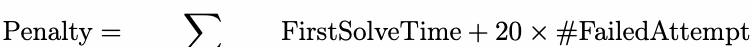

solved problems

In this formula, FirstSolveTime represents the minutes elapsed since the first accepted submission for the

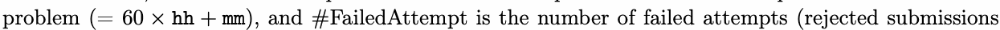

that occurred60 b × ef h o h re + t m h m e first a # ccepted submission).

Teams are ranked in descending order by the number of problems solved. If teams solve the same
number of problems, they are sorted in by penalty. To simplify the problem, teams

number of problems, tdheesyceanredsinorgteodridner ascending order by penalty. To simplify the problem, teams
with share the same rank number. Additionally,

with the same number of problems so a lv sc e e d n a d n in d g p o e r n d a e lt r ies share the same rank number. Additionally,
we will assume that the scoreboard is not frozen during the contest.

we witlhl easssaummee tnhuamt tbheersocofrpebrooabrldemissnsootlvfreodzeannddurpinegnathlteiecsontest.

You can further understand how the ranking system works by observing the subsequent image provided.

## Input

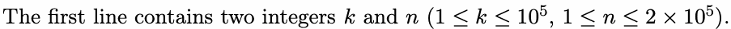

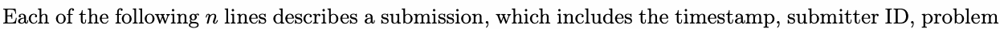

ID, and result type. Tnhe submissions are given in ascending order by timestamp.

It is guaranteed that all timestamps in the input are unique and fall within the range of 00:00:00.000
to .

```cpp
to 04:59:59.999.                                            00:00:00.000
```

## Output

When Team 0 solved a new problem, output one line in the following format: hh:mm:ss.SSS X #x -> #y,
denoting that Team solved problem at time , resulting in their rank changing from

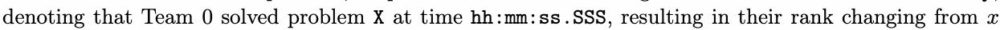

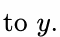

The output should be sorted in ascending order by timestamp. Note that output should be provided

even if the rank did not change after solving a new problem.

## Example

### 样例输入

```text
3 14
00:11:45.140 1 A RJ
00:12:45.140 2 A RJ
00:20:11.111 1 A AC
00:21:22.222 2 A AC
00:41:33.333 0 A AC
00:49:44.444 0 A RJ
00:50:55.555 0 B RJ
01:30:00.666 3 A AC
01:31:11.777 3 B AC
01:32:22.888 3 C RJ
01:40:33.999 1 B AC
02:00:44.000 0 B AC
04:05:55.100 0 C AC
04:59:59.999 0 C AC
```

### 样例输出

```text
00:41:33.333 A #3 -> #2
02:00:44.000 B #3 -> #2
04:05:55.100 C #2 -> #1
```

## Note

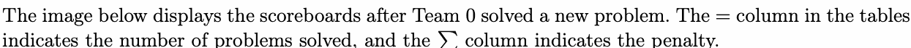

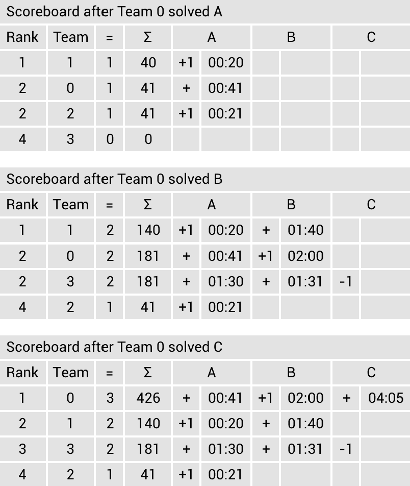
