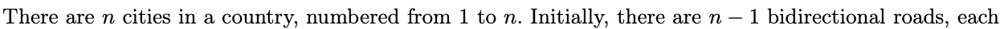
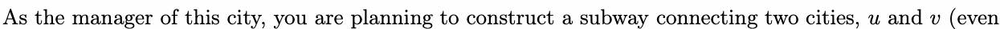
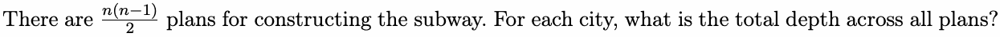
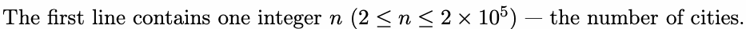
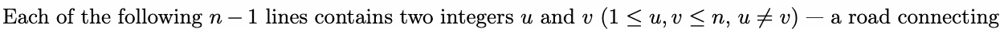
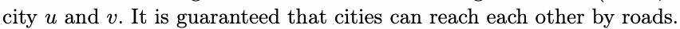
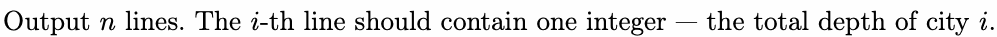
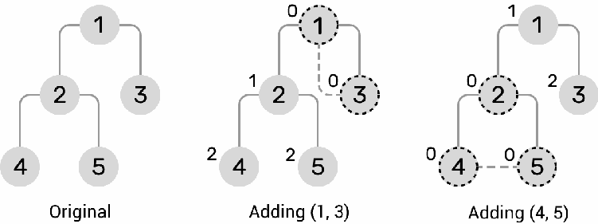

# D. Depths of Cities

Input file: standard input
Output file:

Output file: s s t t a a n n d d a a r r d d i o n u p t u p t ut
Time limit: 1 second

Time limit: s1tsaencdoanrdd

Memory limit: 512 megabytes



connectingntwo cities, ensuring that all cities ca1n reanch each other. In othner−w1ords, the cities and roads

form a tree in graph theory.



if the two cities are already connected directly by a road). This subway will form a cycleuwith svome of

the existing roads, and the cities on the cycle are called key cities. After that, the depth of a city is
defined as the minimum distance between the city and any key city. Here, the distance between two cities

defined as the minimum distance between the city and any kkeeyy cciittyi.esHere, the distance between two cities

is determined by the number of roads needed to travel from one to the other. The depth of key cities is

defined as zero.

Two plans to construct a subway in the first example. The key cities are marked by dashed stroke, and the depth

of each city is given at the top-left of the circle.



## Input







## Output



## Examples

### 样例输入

```text
5
1 2
1 3
2 4
2 5
```

### 样例输出

```text
3
1
9
7
7
```

### 样例输入

```text
7
1 2
1 3
1 4
2 5
2 6
3 7
```

### 样例输出

```text
4
7
13
19
22
22
28
```


