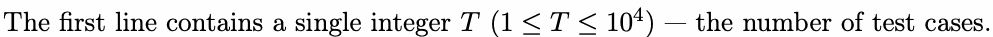
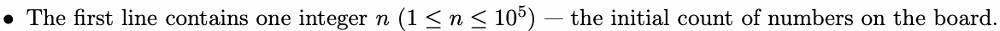
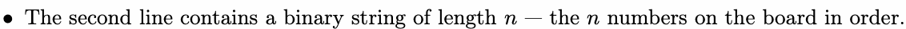
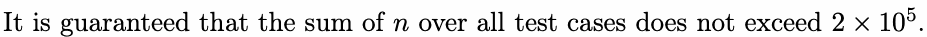

# E. Erasing Numbers

Input file: standard input
Output file:

Output file: s s t t a a n n d d a a r r d d i o n u p t u p t ut
Time limit: 1 second

Time limit: s1tsaencdoanrdd

Memory limit: 512 megabytes


are either 0 or 1. Alice and Bob take turns to move, and Alnice moves first.

On Alice’s turn, she can perform one of the following actions:

- Choose a number 0 on the board and erase it.

- Choose two numbers 0 on the board and erase them with all the numbers between them.


the first four numbers together.

Bob’s actions are similar to Alice’s, but he should choose 1 instead of 0.

To make the game more interesting, Alice and Bob agree that the first person who is unable to perform

any action wins (e.g., no number 0 on the board on Alice’s turn). If both players play optimally, who will
be the winner?

be the winnweirn?

## Input



Each test case consists of two lines:







## Output

For each test case, output a single line containing Alice or Bob — the winner if both players play optimally.

## Example

### 样例输入

```text
3
5
10100
5
11011
5
01010
```

### 样例输出

```text
Alice
Alice
Bob
```
