# F. Finding Maxi-strings

Input file: standard input
Output file:

Output file: s s t t a a n n d d a a r r d d i o n u p t u p t ut
Time limit: 1 second

Time limit: s1tsaencdoanrdd

Memory limit: 512 megabytes

Mike was doing an everyday challenge on a website. One day, the website gave the following challenge:

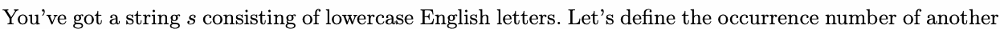

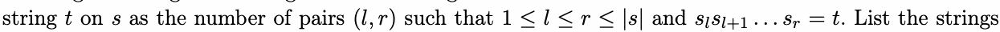

with thte bigsgest occurrence number.

Mike figured out the answer within one second. But after he typed all the answers on the website, he

noticed that many challengers finished faster than him. Mike thought that the problem was the input

order.

The website provides an input area for users to write answers. The input area is initially empty, and the

function of it is limited — only the following actions are allowed:

- Adding a lowercase English letter at the end of the input.

- Pressing “Backspace” to remove one letter from the end of the input. This action only works if there

are letters in the input area.

- Pressing “Enter” to submit an answer based on the current input. The content of the input area

remains unchanged.

The challenge finishes when all the answers are submitted. In addition to the original problem, Mike will

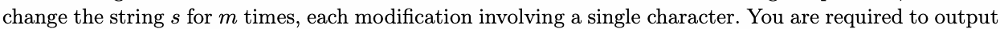

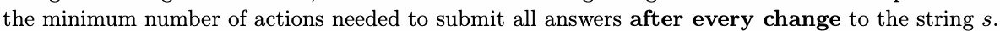

## Input

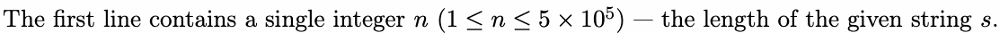

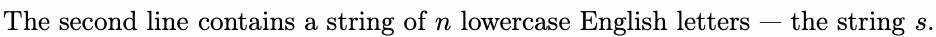

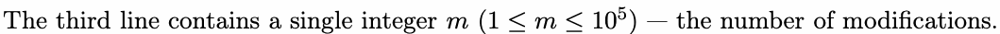

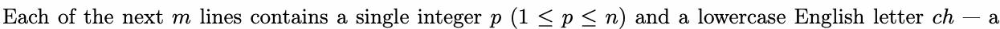

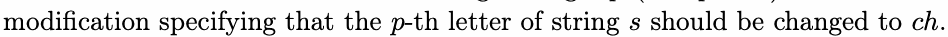

## Output

After each modification, output a single integer in a line — the minimum number of actions required to

submit all answers.

## Examples

### 样例输入

```text
6
ababab
4
1 c
3 c
6 a
5 c
```

### 样例输出

```text
2
2
10
2
```

### 样例输入

```text
23
fadejademadewademinimum
3
1 j
9 j
13 j
```

### 样例输出

```text
18
15
26
```

## Note

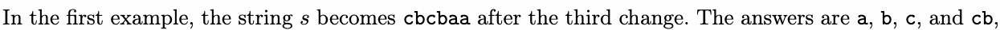

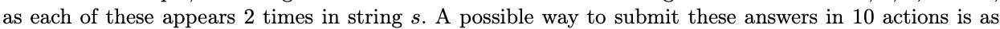

follows:

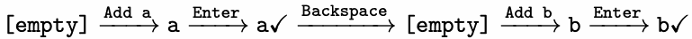

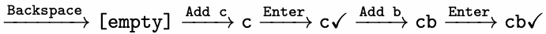
