# G. General Checksum Calculation

Input file: standard input
Output file:

Output file: s s t t a a n n d d a a r r d d i o n u p t u p t ut
Time limit: 2 seconds

Time limit: s2tsaencdoanrdds

Memory limit: 512 megabytes

After several years of hard work, a group of students from Sun Yat-sen University has successfully

developed their first handcrafted CPU, named SYS-Unit. The initial task for SYS-Unit is “General
Checksum Calculation”.

Checksum Calculation”.

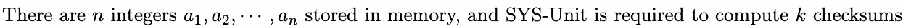

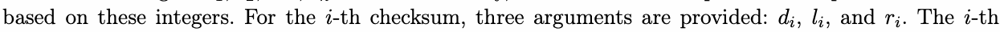

checksum is formulated as:

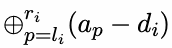

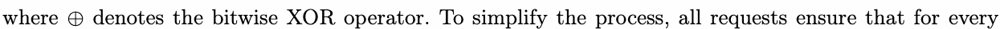

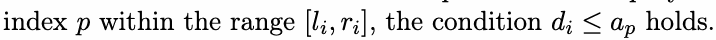

You are asked to pre-compute all checksums in order to verify the correctness of SYS-Unit.

## Input

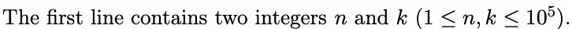

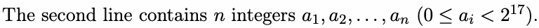

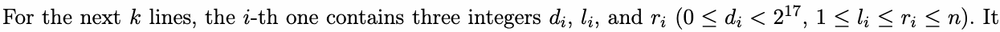

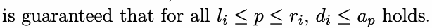

## Output

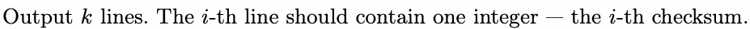

## Example

### 样例输入

```text
7 4
11 45 14 19 19 8 10
1 1 4
5 1 4
1 4 7
14 2 4
```

### 样例输出

```text
57
41
14
26
```

## Note

In the example:

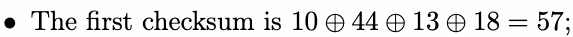

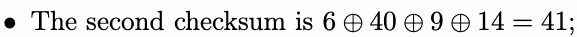

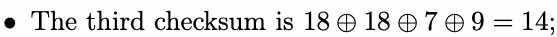

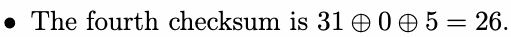
