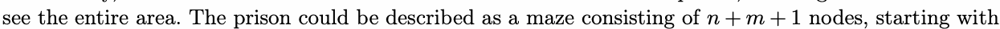
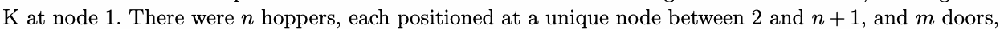
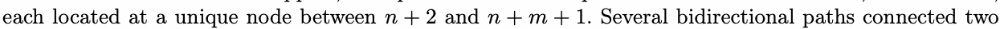
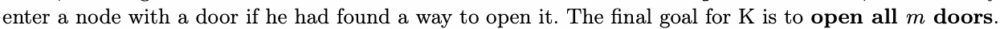
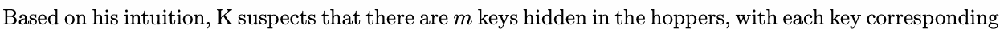
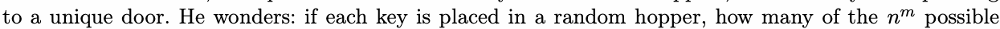
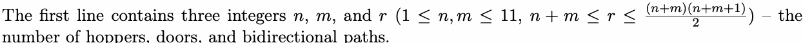
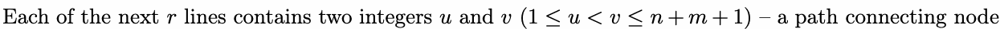
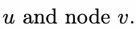
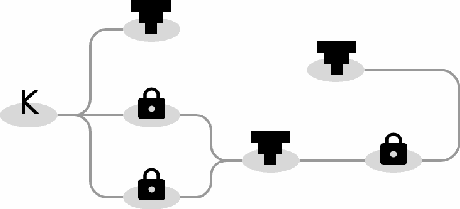

# H. Hoppers and Doors

Input file: standard input
Output file:

Output file: s s t t a a n n d d a a r r d d i o n u p t u p t ut
Time limit: 2 seconds

Time limit: s2tsaencdoanrdds

Memory limit: 512 megabytes

K was trapped in a Minecraft prison created by a YouTuber named Omz, who had a penchant for using

hoppers in his prisons. The hopper in this problem can be viewed as a container that can store any
.

number of items.

Fortunately, he soon realized that barrier blocks did not surround the prison, allowing him to use F5 to
see the entire area. The prison could be described as a maze consisting of nodes, starting with







nodes, ensuring that all nodes can be n re + a 2 ched a n ft + er m a + ll 1 doors are opened. However, K could only
enter a node with a door if he had found a way to open it. The final goal for K is to .



The image above shows the prison specified by the second example.





arrangements of keys in hoppers would allow K to collect all the keys and achieve his goal?

## Input







It is guaranteed that no two paths connect the same two nodes, and all nodes can be reached from node

1 after all doors are opened.

## Output

Output a single integer in a line — the number of possible arrangements of keys in hoppers.



## Examples

### 样例输入

```text
2 2 5
1 2
2 4
2 5
3 4
3 5
```

### 样例输出

```text
3
```

### 样例输入

```text
3 3 7
1 2
1 5
1 6
3 5
3 6
3 7
4 7
```

### 样例输出

```text
10
```
