# I. Isla Loves Christmas

Input file: standard input
Output file:

Output file: s s t t a a n n d d a a r r d d i o n u p t u p t ut
Time limit: 1.5 seconds

Time limit: s1.t5ansedcaornddso

Memory limit: 512 megabytes

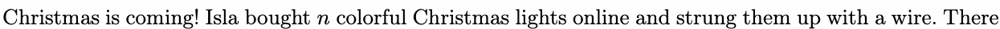

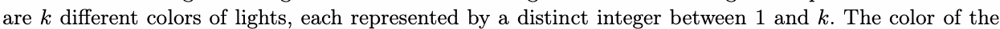

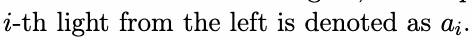

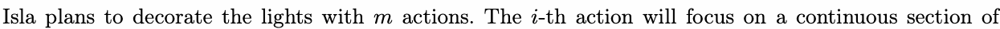

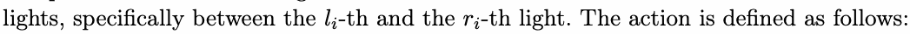

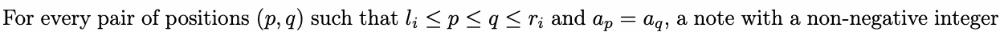

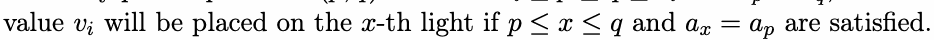

After the actions, Isla wants to know the sum of the values on the notes for each light. As the result can

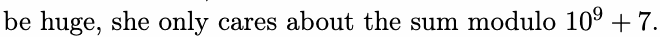

## Input

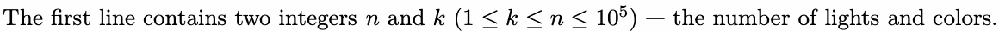

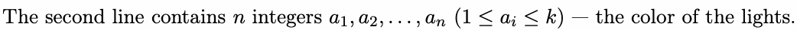

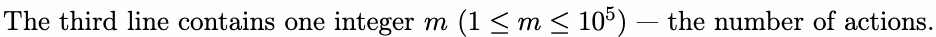

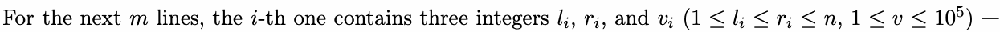

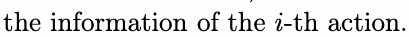

## Output


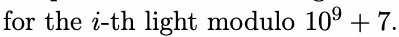

## Example

### 样例输入

```text
10 3
3 3 1 1 2 1 1 2 2 2
3
1 9 1
3 7 10
5 10 100
```

### 样例输出

```text
2 2 44 66 413 266 244 604 603 400
```
