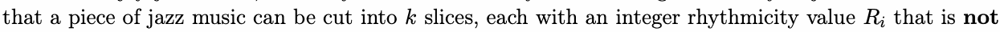
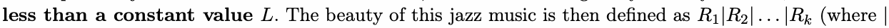
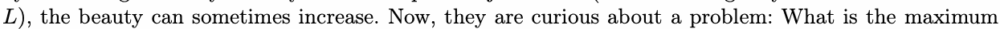
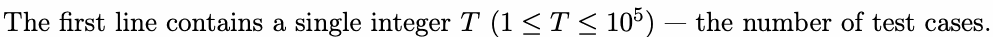
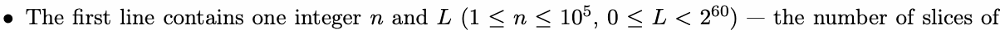
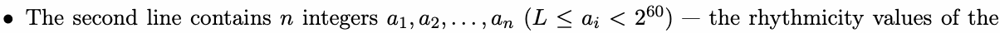
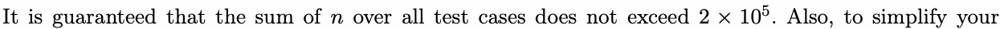

# J. Jazz Music from the Er-th

Input file: standard input
Output file:

Output file: s s t t a a n n d d a a r r d d i o n u p t u p t ut
Time limit: 1 second

Time limit: s1tsaencdoanrdd

Memory limit: 512 megabytes

You may have heard about the new planet discovered by humans — The Er-th. The “Er” in its name

means two, as creatures on this planet only use binary integers and operations (e.g., and, or, xor).

Scientists have found a way to communicate with these creatures. The discovery indicates that the

creatures enjoy jazz music, and they have a formal way of evaluating the beauty of jazz music. Assume





ldeesnsottehsatnheabcitownissteaOnRt voapleureatLor).

After learning subtraction from human beings, the creatures figure out a new way to compose jazz music —

by decreasing some rhythmicity values of a piece of jazz music (while ensuring they remain not less than
), the beauty can sometimes increase. Now, they are curious about a problem: What is the maximum



Lbeauty of a piece of jazz music that can be achieved by decreasing some (possibly none) rhythmicity

values?

## Input



Each test case consists of two lines:



the music and the constant value.



music.



research, all numbers in the input nwill be given in decimal.

## Output

For each test case, output a single integer in a line — the maximum beauty the music can achieve. Your

output should also be given in decimal.

## Example

### 样例输入

```text
3
3 100
1924 100 2024
4 10
10 34 16 10
4 16
260 128 84 36
```

### 样例输出

```text
2047
59
503
```

## Note

In the second test case, the maximum beauty of 59 can be achieved by decreasing the second rhythmicity
value to .

value to 33.

In the third test case, the maximum beauty of 503 can be achieved by decreasing each rhythmicity value
to , , , and , respectively.

to 258, 128, 84, and 33, respectively.
