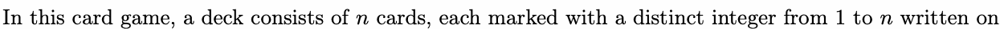
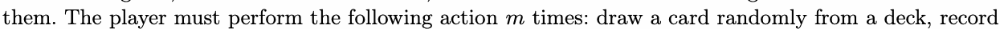
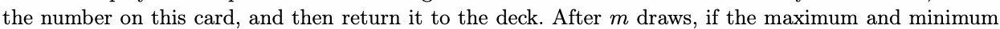
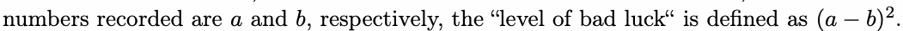
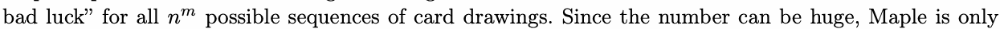
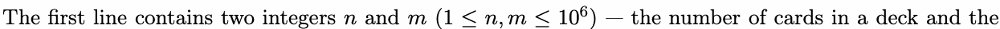
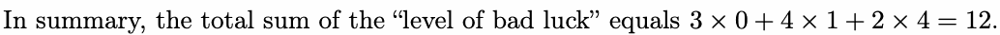

# K. King of Card Games

Input file: standard input
Output file:

Output file: s s t t a a n n d d a a r r d d i o n u p t u p t ut
Time limit: 1 second

Time limit: s1tsaencdoanrdd

Memory limit: 512 megabytes

An innovative card drawing game, developed by K7K7 Games, has become famous among ACMM Club.









Maple aspires to become the king of card games. She is curious about the total sum of the “level of



interested in the snum modulo 998 244 353.

## Input



number of card draws.

## Output

Output a single integer — the total sum of the “level of bad luck” modulo 998 244 353.

## Examples

### 样例输入

```text
3 1
```

### 样例输出

```text
0
```

### 样例输入

```text
3 2
```

### 样例输出

```text
12
```

### 样例输入

```text
114 514
```

### 样例输出

```text
486446955
```

## Note

In the first example, the “level of bad luck” is always zero since only one number is recorded.

In the second example, there are 9 possible sequences of card drawings.

- Three of the sequences have a “level of bad luck” of 0;

- Four of the sequences have a “level of bad luck” of 1;

- Two of the sequences have a “level of bad luck” of 4.


