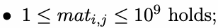
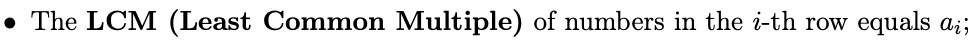
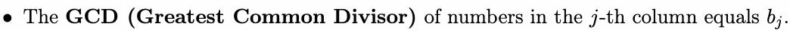
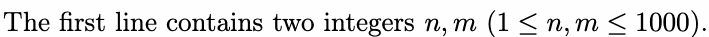
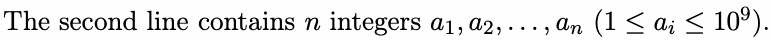
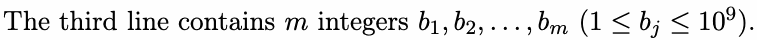

# L. LCM and GCD

Input file: standard input
Output file:

Output file: s s t t a a n n d d a a r r d d i o n u p t u p t ut
Time limit: 1 second

Time limit: s1tsaencdoanrdd

Memory limit: 512 megabytes

As you all know, you are participating in the SYSUCPC (SYSU Constructive Problem Contest) finals.

Undoubtedly, the Constructive Kingdom of Sun Yat-sen University is eager for you to tackle some related

problems.

Before you challenge the problem from the constructive kingdom, here’s another constructive problem for

you to warm up.


good if it satisfines all requair1e,ma2e,n.t.s.b,aelnow:







Construct a good matrix or determine if it is impossible.

## Input







## Output

If it’s impossible to construct a good matrix, output a single line containing No.


your construction. IYfetshere are multiple answers, print anynof them.

You can output Yes and No in any case (for example, strings yEs, yes, and YES will be recognized as a
positive response).

positive responseY).e

## Examples

### 样例输入

```text
2 3
2 6
1 2 2
```

### 样例输出

```text
Yes
2 2 2
1 6 2
```

### 样例输入

```text
3 3
1 1 4
5 1 4
```

### 样例输出

```text
No
```
