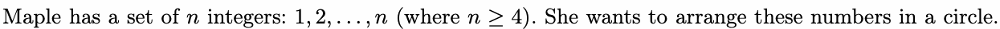
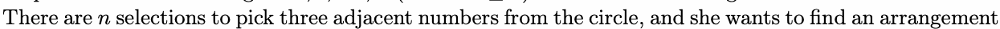
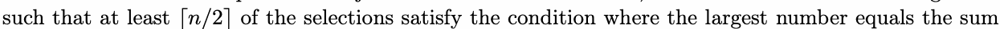
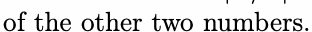
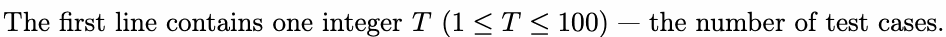
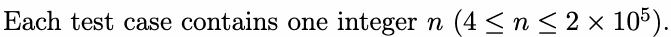
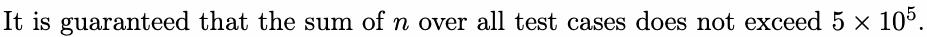
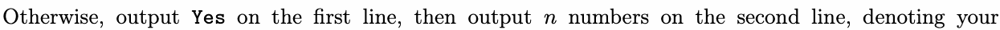
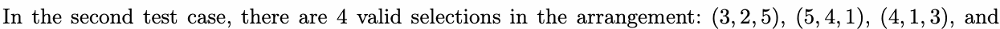
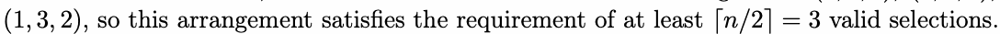

# M. Make SYSU Great Again 3

Input file: standard input
Output file:

Output file: s s t t a a n n d d a a r r d d i o n u p t u p t ut
Time limit: 1 second

Time limit: s1tsaencdoanrdd

Memory limit: 512 megabytes

As you all know, you are participating in the SYSUCPC (SYSU Constructive Problem Contest) finals.

Undoubtedly, the Constructive Kingdom of Sun Yat-sen University is eager for you to tackle some related

problems.









As a friend of Maple, you are asked to either construct such an arrangement or determine that it does

not exist.

## Input







## Output

For each test case:

If it’s impossible to construct the arrangement, output a single line containing No.



construction. If therYeeasre multiple answers, print any of tnhem.

You can output Yes and No in any case (for example, strings yEs, yes, and YES will be recognized as a
positive response).

positive responseY).e

## Example

### 样例输入

```text
2
4
5
```

### 样例输出

```text
Yes
4 1 3 2
Yes
3 2 5 4 1
```

## Note






