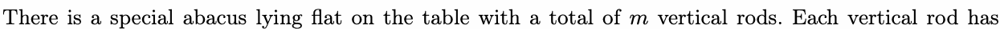
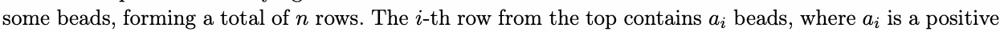
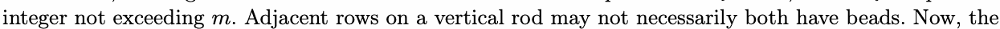
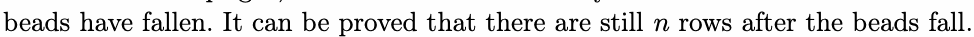
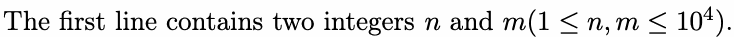
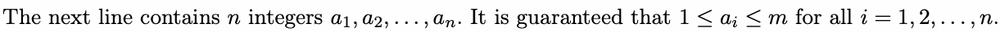
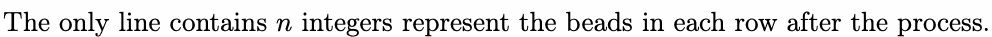
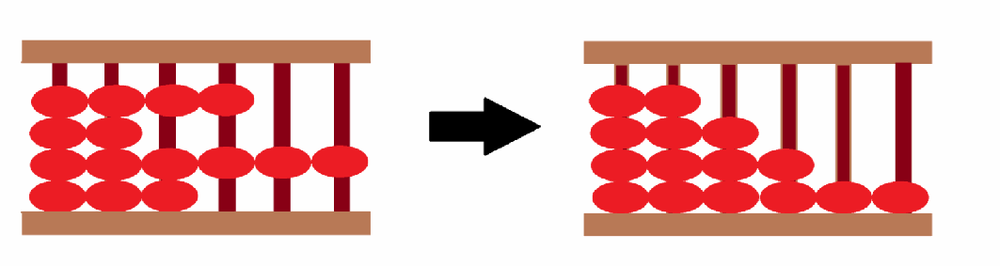

# A. Abacus

Input file: standard input
Output file:

Output file: s s t t a a n n d d a a r r d d i o n u p t u p t ut
Time limit: 2 seconds

Time limit: s2tsaencdoanrdds

Memory limit: 128 megabytes







abacus is stood uprighmt, and all beads fall naturally. Determine the number of beads in each row after the



The process for the first sample case is as follows:

## Input





## Output



## Examples

### 样例输入

```text
4 6
4 2 6 3
```

### 样例输出

```text
2 3 4 6
```

### 样例输入

```text
7 10
3 6 6 4 3 1 5
```

### 样例输出

```text
1 3 3 4 5 6 6
```


