# B. Network

Input file: standard input
Output file:

Output file: s s t t a a n n d d a a r r d d i o n u p t u p t ut
Time limit: 1 second

Time limit: s1tsaencdoanrdd

Memory limit: 256 megabytes

Computer Networks is a very important course in computer science. Suppose there are two machines, A

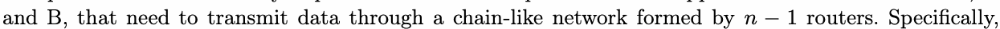

when machine A wants to send data to machine B, it first sends the data to rounte−r 11, which then forwards

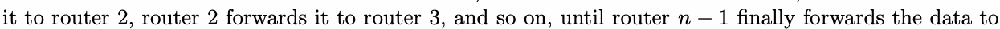

machine B.

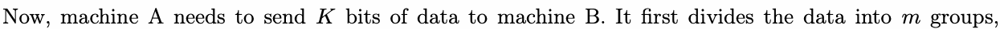

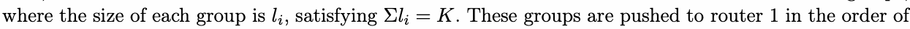

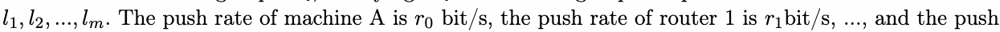

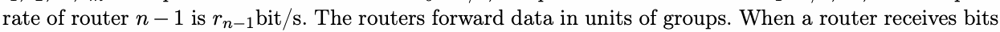

from a group,nit−w1aitsrnu−n1til all bits of that group have arrived before starting to push the group to the

next router. The forwarding strategy of the routers is first-come-first-served. While a router is forwarding

data from one group, data from other groups is stored in the router’s buffer, waiting to be forwarded.

Assume that once a router or machine pushes a bit, the bit immediately arrives at the next router or

machine. The question is: starting from the time when machine A pushes the first bit, at what time will

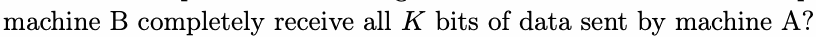

## Input

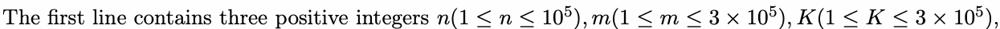

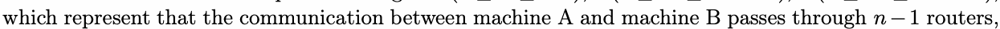

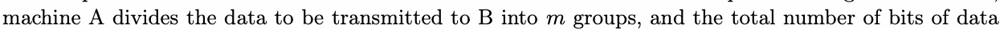

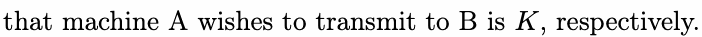

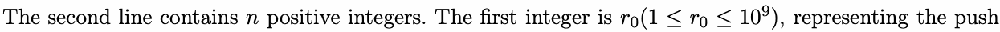

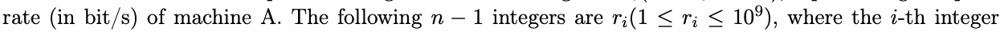

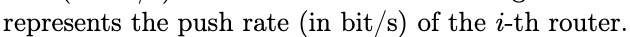

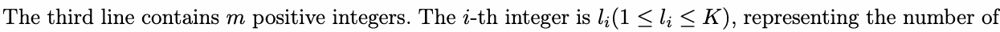

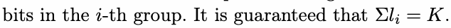

## Output

A real number, in seconds, representing the time from when machine A pushes the first bit until machine

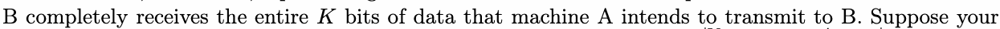

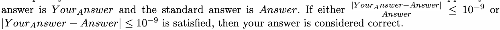

## Example

### 样例输入

```text
2 2 3
2 1
1 2
```

### 样例输出

```text
3.500000000000000
```

## Note

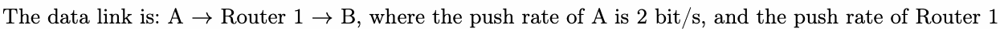

is 1 bit/s.

A intends to transmit 3 bits of data to B. Before sending, A divides the data into two groups, with lengths

of 1 bit and 2 bits, respectively. A first pushes the group of length 1, followed by the group of length 2.


the second group does not need to queue at Router 1 and can be pushed out immediately. Therefore, the

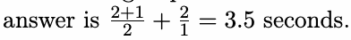
