# C. Arc Path

Input file: standard input
Output file:

Output file: s s t t a a n n d d a a r r d d i o n u p t u p t ut
Time limit: 1.5 seconds

Time limit: s1.t5ansedcaornddso

Memory limit: 256 megabytes

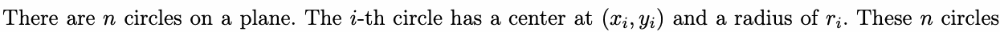

are pairwisne non-intersecting, but theiy may be tangent (includin(xgi,inytie)rnally or externalrlyi ). Therenare two

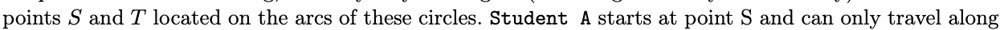

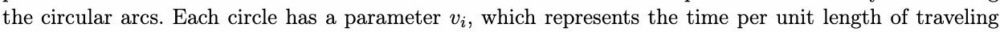

along the arc of that circle. The goal is to find thvie minimum total time for Student A to travel from point
to point along the circular arcs.

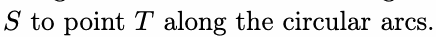

## Input

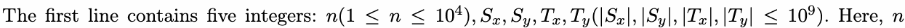

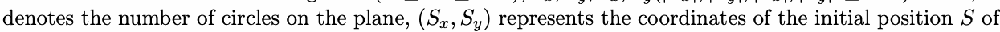

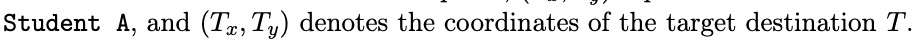

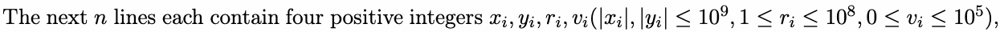

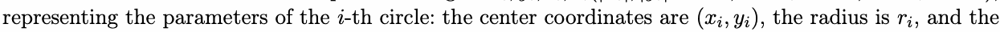

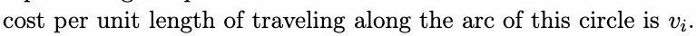

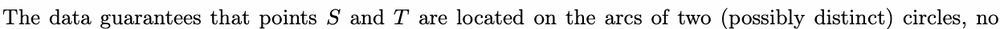

two circles intersect (they may be StangentT, either internally or externally), and no two circles are entirely

coincident (i.e., there are no two circles with identical center coordinates and equal radius).

## Output

Output a single line containing a real number, which represents the minimum total cost for Student A
to travel from point to point . If it is impossible to reach the destination, output .

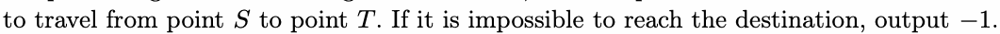

The correctness of your answer is judged as follows:

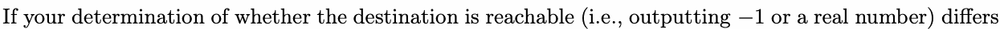

from the standard answer, your answer is considered wrong.

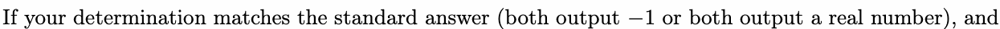

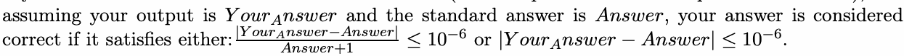

## Examples

### 样例输入

```text
3 0 1 3 0
1 1 1 1
3 1 1 2
4 1 4 3
```

### 样例输出

```text
6.283185307179586
```

### 样例输入

```text
3 -10 0 0 0
0 0 10 2
0 0 8 3
0 4 4 5
```

### 样例输出

```text
-1
```

## Note

As shown in the example figure above, Circle 1 is denoted by the lowercase letter a, Circle 2 by b, and

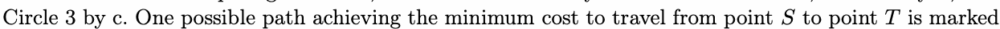

by the red path.

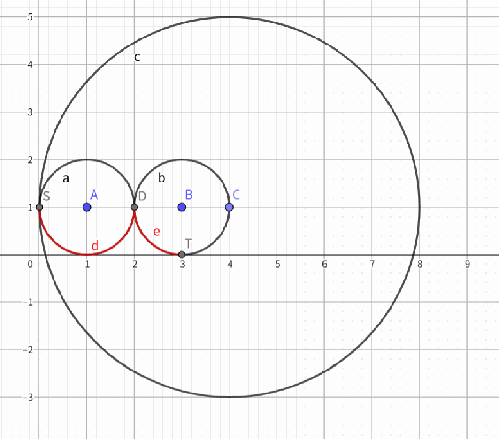
