# D. Perfect Life

Input file: standard input
Output file:

Output file: s s t t a a n n d d a a r r d d i o n u p t u p t ut
Time limit: 1 second

Time limit: s1tsaencdoanrdd

Memory limit: 256 megabytes

Dr.Z wants to live a perfect life. In the future, he acquires a time machine that gives him a chance to
alter his life. His life is represented by a string . He can modify the string using another string .

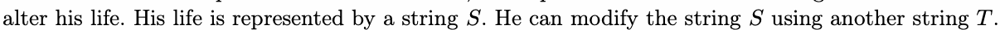

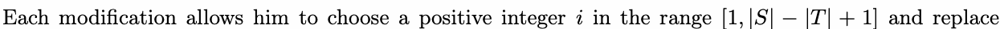

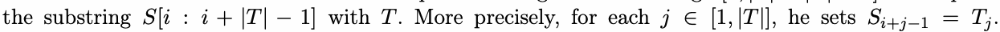

This operationS[cian: ibe+p|Ter|fo−rm1e]d infinTitely many times.Dr.Z consijder∈s [h1i,s|Tli|f]e perfect iSfi+ajn−d1 o=nlyTjif
—that is, when the string becomes a palindrome.

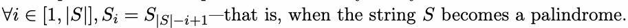

Dr.Z wants to know whether it’s possible for his life to become perfect through these modifications.

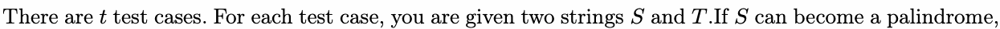

output Yes t. Otherwise, output No.

## Input

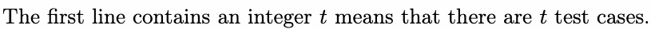

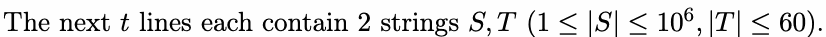

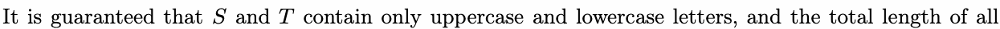

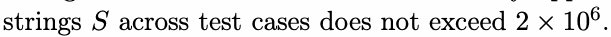

## Output

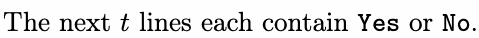

## Example

### 样例输入

```text
9
asdppsaAA Aad
pjdaAjcKaA Aad
pjdsdAadaA Aad
pjdjAjcKsA Aad
ABAB AB
BBA AB
abcdDea cd
abcdDea cb
asbAADbbaaa abbc
```

### 样例输出

```text
Yes
Yes
Yes
No
No
Yes
No
Yes
Yes
```

## Note

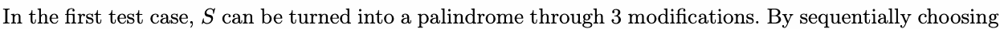

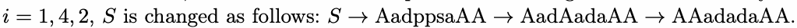

In the fourth test case,there is no way to change.
