# E. Ecosystem

Input file: standard input
Output file:

Output file: s s t t a a n n d d a a r r d d i o n u p t u p t ut
Time limit: 1 second

Time limit: s1tsaencdoanrdd

Memory limit: 256 megabytes

Dr.Orange is conducting research in animal psychology, and one of the studies involves inferring the
number of each animal in the ecosystem based on their dietary habits. It is known that there are types

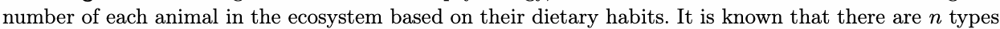

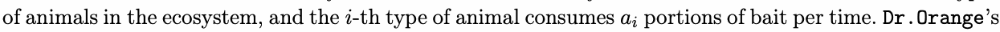

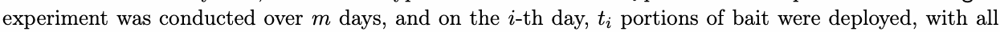

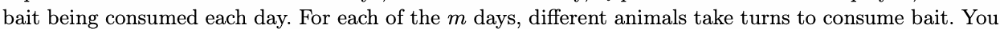

need to answer how many different eating sequmences. Two sequences are the same only if the animals at

each position in the sequence are of the same species. Since this result can be very large, please provide

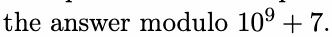

## Input

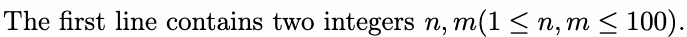

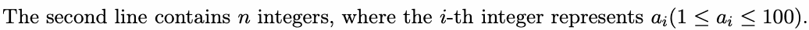

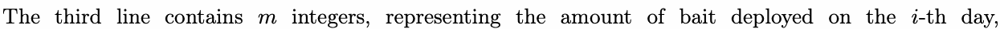

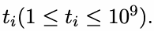

## Output

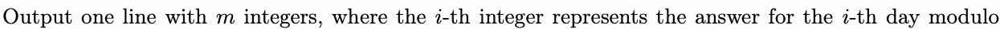

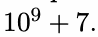

## Examples

### 样例输入

```text
5 3
5 4 4 2 3
5 8 3
```

### 样例输出

```text
3
16
1
```

### 样例输入

```text
10 5
9 1 6 5 10 4 9 2 7 6
64 92 43 30 2
```

### 样例输出

```text
566507809
840913760
608266829
85862862
2
```

## Note

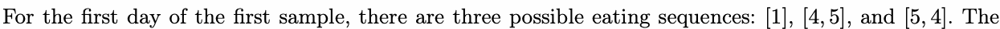

numbers in the sequences represent the types of animals.
