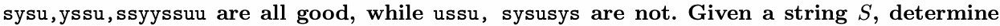
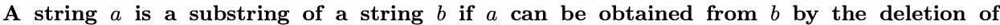

# F. SYSU II

Input file: standard input
Output file:

Output file: s s t t a a n n d d a a r r d d i o n u p t u p t ut
Time limit: 1 second

Time limit: s1tsaencdoanrdd

Memory limit: 256 megabytes

As you all know, you are participating in the SYSUCPC (SYSU Counting Periodic-string Contest) finals.

A string is considered good if and only if it can be rearranged into a perfectly periodic

string with sysu as its period (which means several sysu repetitions). For example,



how many of its substrings are good.



several (possibly zero or all) characters from the beginning and several (possibly zero or all)

characters from the end.

## Input


lowercase English letters.

## Output


## Example

### 样例输入

```text
ilovesysusysu
```

### 样例输出

```text
6
```

## Note

There are 6 good substrings : sysu,ysus,susy,usys,sysu,sysusysu.
