# G. Gray Transform

Input file: standard input
Output file:

Output file: s s t t a a n n d d a a r r d d i o n u p t u p t ut
Time limit: 1 second

Time limit: s1tsaencdoanrdd

Memory limit: 256 megabytes

Gray code is a binary numeral system where two successive values differ in only one bit. This

property makes it useful in various applications, such as minimizing errors in digital communication

and measurement systems. Gray code is also known for its reflective and cyclic characteristics, which help

eliminate significant errors during random sampling. It was invented by Frank Gray in the 1940s and has

various construction methods.

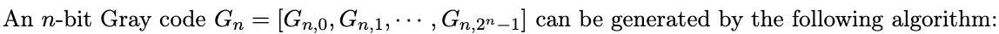

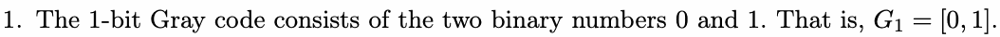

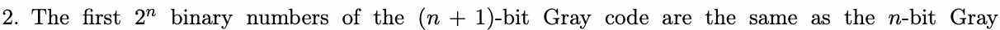

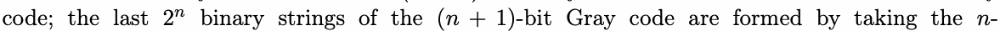

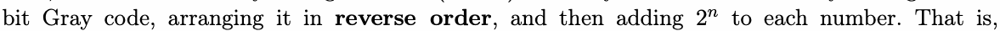

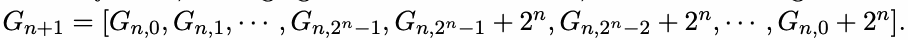

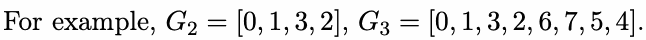

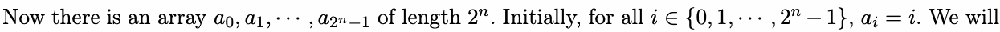

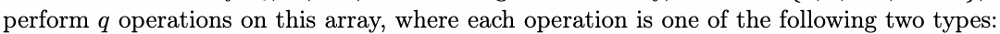

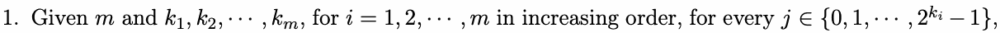

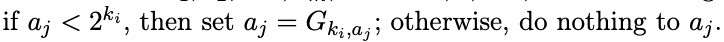

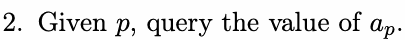

Please output the results of each query in order.

## Input

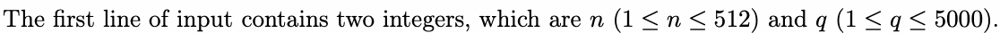

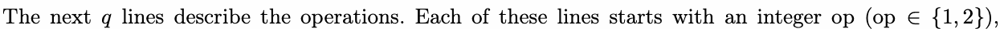

indicating qthe type of operation.

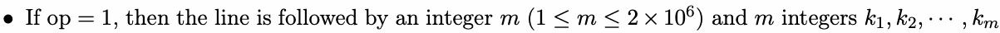

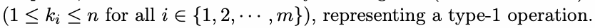

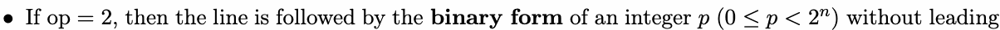

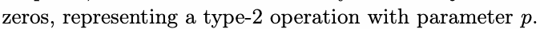

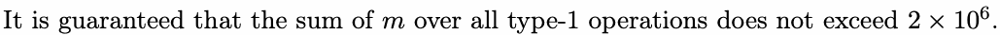

## Output

Output the binary forms of all the results of the type-2 operations without leading zeros, each on its
own line.

own line.

## Example

### 样例输入

```text
3 4
2 0
1 4 1 2 3 2
2 100
2 10
```

### 样例输出

```text
0
110
11
```

## Note

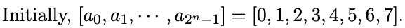

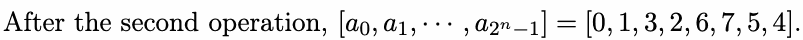
