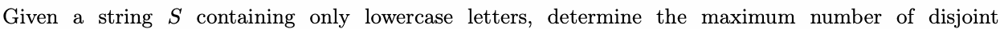
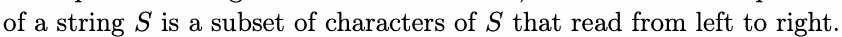
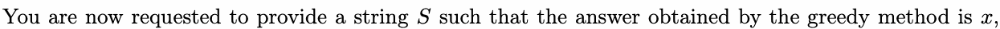
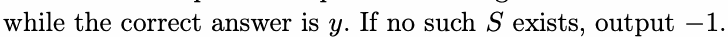
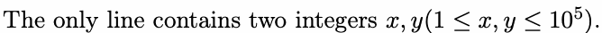
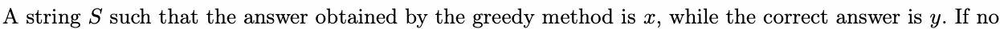
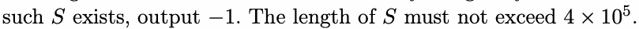

# H. SYSU III

Input file: standard input
Output file:

Output file: s s t t a a n n d d a a r r d d i o n u p t u p t ut
Time limit: 1 second

Time limit: s1tsaencdoanrdd

Memory limit: 256 megabytes

As you all know, you are participating in the SYSUCPC (SYSU Constructive Problem Contest) finals.

Undoubtedly, the Constructive Kingdom of Sun Yat-sen University is eager for you to tackle some related

problems.



subsequences of leSngth 4 that can be formed, such that all subsequences are sysu. Formally, a subsequence
of a string is a subset of characters of that read from left to right.



A greedy algorithm is currently used: each time, starting from the end, an unused u is considered, and it is
matched with nearest unused sequentially to form a qualified subsequence, which is then removed.

matched with nearest unused s,y,s sequentially to form a qualified subsequence,uwhich is then removed.





## Input



## Output





## Examples

### 样例输入

```text
1 1
```

### 样例输出

```text
ilovesysu
```

### 样例输入

```text
2 1
```

### 样例输出

```text
-1
```
