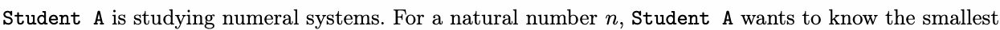
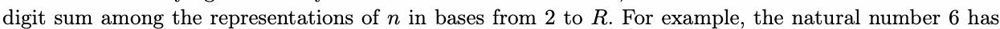
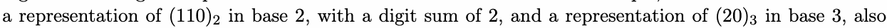
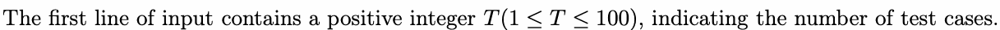
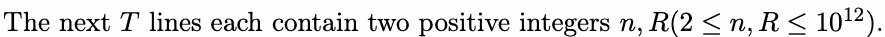
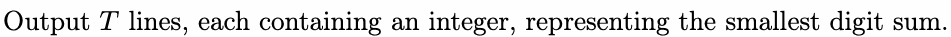

# I. Sum

Input file: standard input
Output file:

Output file: s s t t a a n n d d a a r r d d i o n u p t u p t ut
Time limit: 2 seconds

Time limit: s2tsaencdoanrdds

Memory limit: 256 megabytes







with a digit sum of ( 2 1.1

## Input

There are multiple test cases.





## Output



## Example

### 样例输入

```text
4
6 3
7 4
30 5
999967000273 999983
```

### 样例输出

```text
2
3
2
3
```

## Note

For 6, the digit sum is minimized in base 2 or base 3. For 7, the digit sum is minimized in base 2 or base
. For , the digit sum is minimized in base .

3. Fo6r 30, the digit sum is minimized in b2ase 5.
