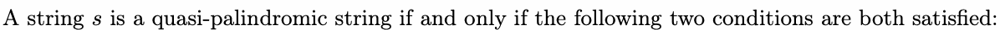
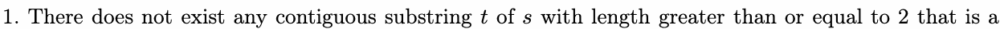
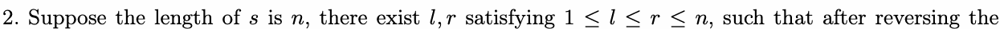
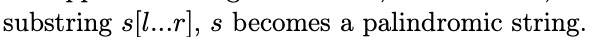
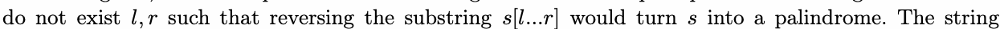
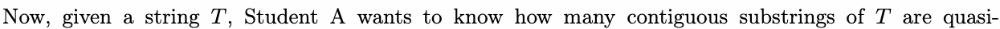
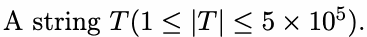
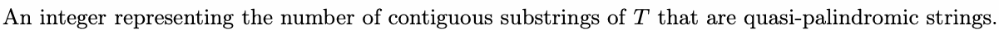

# J. Palindrome

Input file: standard input
Output file:

Output file: s s t t a a n n d d a a r r d d i o n u p t u p t ut
Time limit: 5 seconds

Time limit: s5tsaencdoanrdds

Memory limit: 256 megabytes

Recently, Student A has been studying strings. Certain peculiar strings caught his attention, so he named

such strings “quasi-palindromic strings“.





palindromic string.





For example: The string “aac“ is not a quasi-palindromic string because it contains the contiguous substring

“aa“ of length 2, which is a palindrome. The string “abdc“ is not a quasi-palindromic string because there



“bcabca“ is a lq,urasi-palindromic string.



palindromic strings.

Here, contiguous substrings are distinguished solely by their starting and ending positions in the original

string. For instance, in the string “aba“, the contiguous substring [1,1] (the first “a“) and the contiguous

substring [3,3] (the last “a“) are considered two different contiguous substrings, even though they are both

the character “a“.

## Input



## Output



## Examples

### 样例输入

```text
abcabc
```

### 样例输出

```text
9
```

### 样例输入

```text
abc
```

### 样例输出

```text
3
```

## Note

In the first sample, all contiguous substrings of length 1 are quasi-palindromic strings. Among substrings

longer than 1, the quasi-palindromic strings are “abcab“, “bcabc“, and “abcabc“.
