# K. Divisor Transformation

Input file: standard input
Output file:

Output file: s s t t a a n n d d a a r r d d i o n u p t u p t ut
Time limit: 3 seconds

Time limit: s3tsaencdoanrdds

Memory limit: 256 megabytes

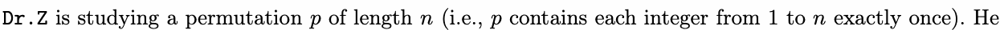

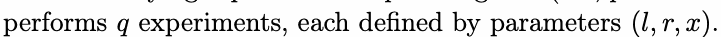

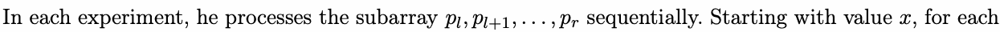

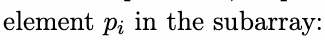

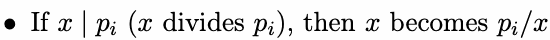

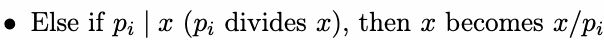

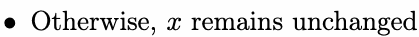

Dr.Z needs your help to compute:

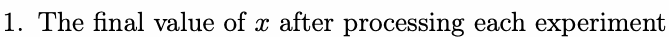

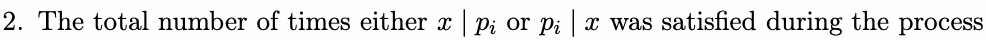

## Input

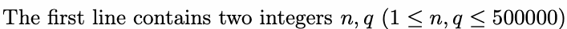

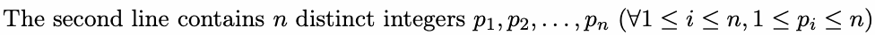

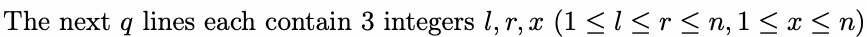

## Output

For each experiment, output two integers:

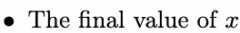

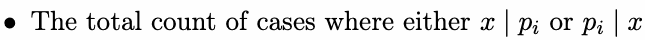

## Example

### 样例输入

```text
6 6
1 4 3 2 5 6
1 6 4
3 4 2
3 4 4
5 5 1
2 5 3
6 6 4
```

### 样例输出

```text
2 4
1 1
2 1
5 1
2 2
4 0
```
