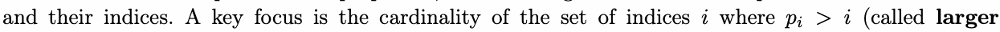
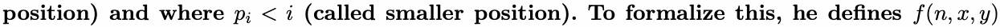
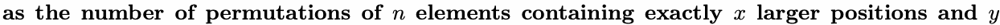
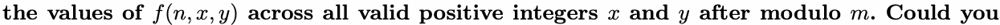
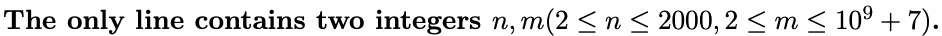
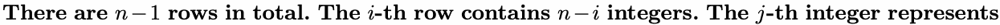
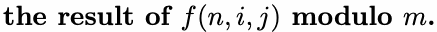
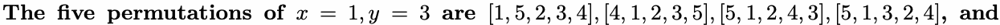
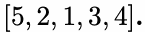

# L. Larger or Smaller

Input file: standard input
Output file:

Output file: s s t t a a n n d d a a r r d d i o n u p t u p t ut
Time limit: 1 second

Time limit: s1tsaencdoanrdd

Memory limit: 256 megabytes

In his recent work on permutation properties, Dr.Z investigates the relationship between element values
and their indices. A key focus is the cardinality of the set of indices where (called







smaller positions. Dr.Z now aims to characterize this function completely by determining



help him solve this problem efficiently?

## Input



## Output





## Example

### 样例输入

```text
5 998244353
```

### 样例输出

```text
10 10 5 1
10 35 21
5 21
1
```

## Note




