# M. Road2

Input file: standard input
Output file:

Output file: s s t t a a n n d d a a r r d d i o n u p t u p t ut
Time limit: 3 seconds

Time limit: s3tsaencdoanrdds

Memory limit: 1024 megabytes

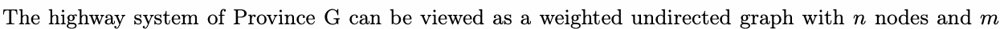

edges. Each edge represents a segment of the highway, and each node represents a city.nEvery highwamy

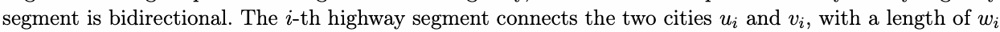

kilometers.

Miss Orange is currently commuting in Province G. Her car consumes one unit of fuel per kilometer
traveled. Any city has a gas station where the car’s fuel tank can be fully refilled, and the fuel consumption

MtriasvseleOdr.aAngney city has a gas station where the car’s fuel tank can be fully refilled, and the fuel consumption

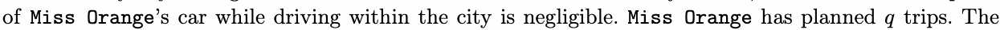

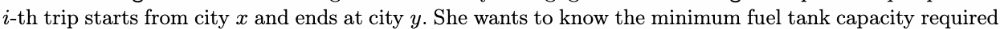

ifor this trip.

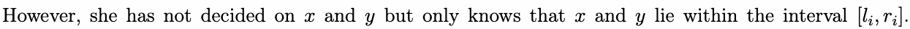

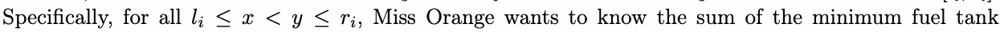

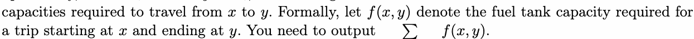

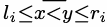

Since she needs to consider her next plan based on the current one, certain constraints will be imposed

on you in the problem.

## Input

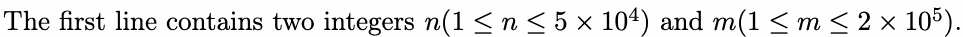

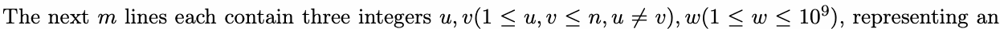

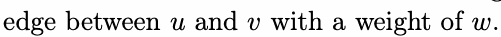

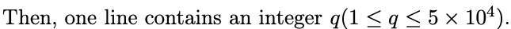

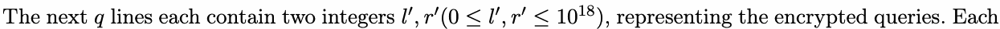

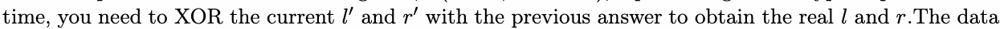

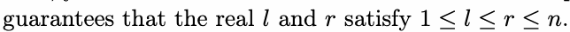

## Output

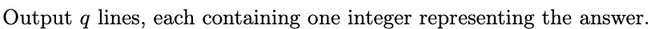

## Example

### 样例输入

```text
5 10
1 2 13
1 3 13
1 4 12
4 5 11
4 4 7
4 2 10
4 5 13
1 4 8
2 4 8
3 4 8
5
4 4
2 4
28 29
10 10
1 5
```

### 样例输出

```text
0
24
11
0
92
```
