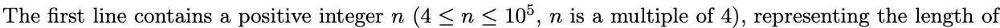
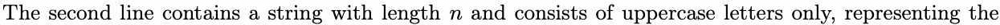

# A. Journey of SYSU

Input file: standard input

Output file: standard output

Time limit: 1 second

Memory limit: 256 megabytes

This year is the 100th anniversary of the founding of Sun Yat-sen University. In order to show the

commemoration of this anniversary, the ACMM Association decided to add elements related to the

anniversary in this contest.

You are given a string that is exactly a multiple of four in length and consists of uppercase letters only.

You are allowed a number (possibly zero) of operations, each of which allows you to select a letter of the

string and modify it to any uppercase letter.

Your final goal is to modify this string to a string with SYSU as a period (e.g. SYSU, SYSUSYSU,

SYSUSYSUSYSU). What is the minimum number of operations required to accomplish this goal?

## Input



the string.



string given to you.

## Output

Output a single integer, denoting the answer.

## Examples

### 样例输入

```text
12
SPSKBYSHQASY
```

### 样例输出

```text
7
```

### 样例输入

```text
12
SYSUSYSUSYSU
```

### 样例输出

```text
0
```

## Note

In the first example, you need to change at least 7 positions to make the string equal to SYSUSYSUSYSU.

In the second example, the string itself satisfies the requirement, so no operation is needed.
