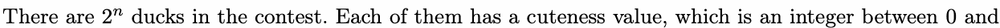
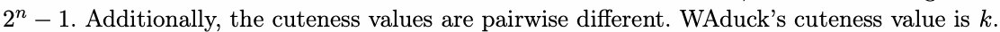
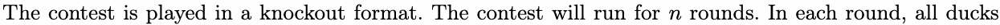
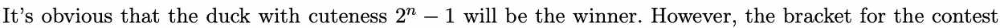
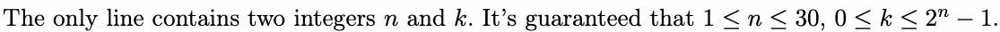
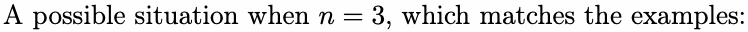
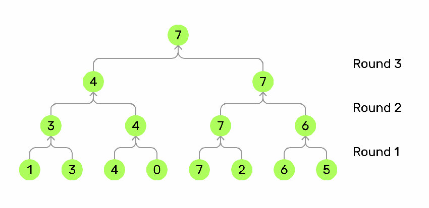
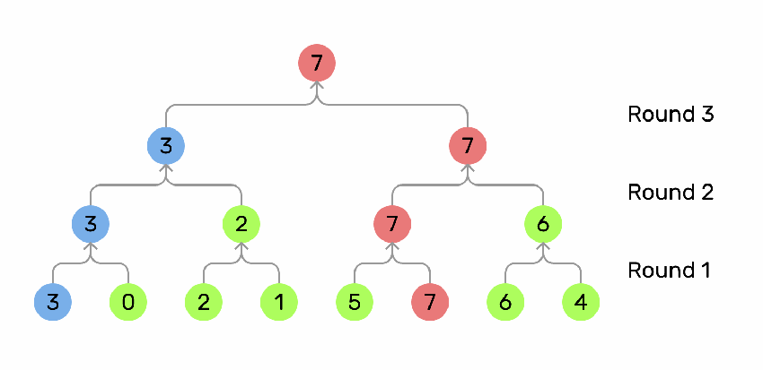

# B. WAduck and Cuteness Contest

Input file: standard input

Output file: standard output

Time limit: 1 second

Memory limit: 256 megabytes

WAduck is a cute duck. One day, he registers for a cuteness contest.







are paired based on the bracket. For each pair, the duck with larger cuteness wins and moves to the next

round, and the other loses and is eliminated from the contest.

An example of a cuteness contest.



is unknown before the contest, so the ducks don’t know their opponents in each round. WAduck wonders

how many times he can win at most.

## Input



## Output

Output a single integer, denoting your answer.

## Examples

### 样例输入

```text
3 3
```

### 样例输出

```text
2
```

### 样例输入

```text
3 7
```

### 样例输出

```text
3
```

## Note






