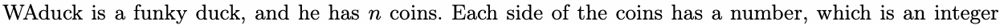
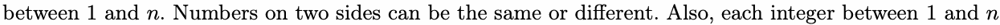
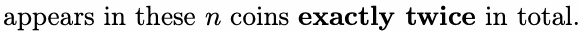
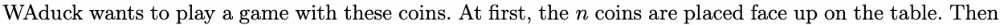
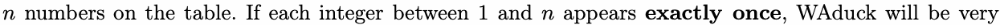
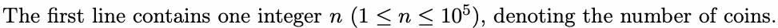
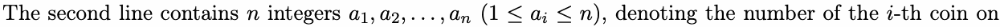
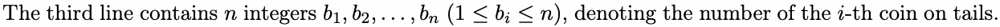
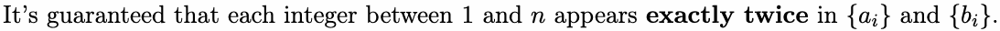
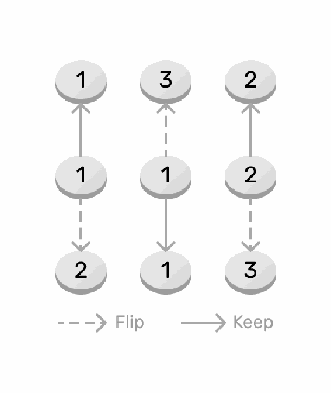

# C. WAduck Rotates For One Minute

Input file: standard input

Output file: standard output

Time limit: 1 second

Memory limit: 256 megabytes









WAduck chooses some of the coins (possibly none of them) and flips them. After that, WAduck can see



thrilled and rotate for one minute.

WAduck wonders how many kinds of choices to flip coins can make him thrilled. As the answer can be

very large, you need to output the answer modulo 1 000 000 007.

## Input





heads.





## Output

Output a single integer, denoting your answer modulo 1 000 000 007.

## Examples

### 样例输入

```text
3
1 1 2
2 3 3
```

### 样例输出

```text
2
```

### 样例输入

```text
2
1 2
1 2
```

### 样例输出

```text
4
```

## Note

In the first example, there are 2 choices:

In the second example, whatever WAduck flips, the result can always make WAduck thrilled, so there are

4 choices.


