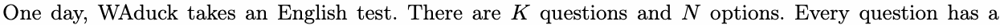
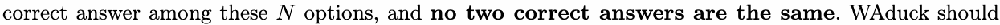
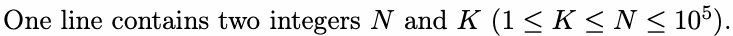

# D. WAduck Gets Wrong Answer

Input file: standard input

Output file: standard output

Time limit: 1 second

Memory limit: 256 megabytes

WAduck’s English is bad.





write an option to each question, and no two options written are the same either. WAduck can get

1 point from each question if his answer to the question matches the correct answer.

Here is an example. Assume that the options are A,B,C,D,E,F,G. If the correct answer is BCGFA and

WAduck’s answer is BAGFD, then WAduck gets 3 points.

Unfortunately, WAduck gets 0 points in the end, so he wants to know how many different answers will

get 0 points when the correct answer is fixed. As the number can be very large, you need to output the

answer modulo 1 000 000 007.

Two answers are considered different if they give different options to at least one question.

## Input



## Output

Output a single integer, denoting the number of answers modulo 1 000 000 007.

## Example

### 样例输入

```text
4 2
```

### 样例输出

```text
7
```

## Note

In the example, we can assume the correct answer is AB, then there are 7 answers that get 0 points:

```cpp
BA,BC,BD,CA,CD,DA,DC.
```
