# E. Shield Block

Input file: standard input

Output file: standard output

Time limit: 2 seconds

Memory limit: 256 megabytes

Little Q is playing Hearthstone, and his opponent is a Warrior who is skilled at getting armor.

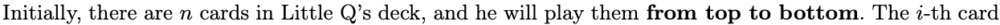

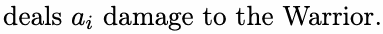

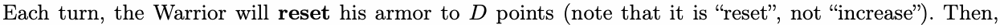

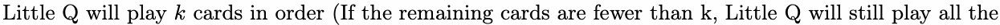

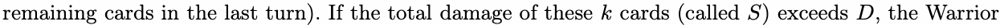

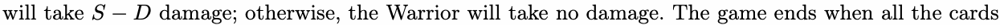

in Little Q’s deck have been played.

Little Q has a special ability: he can remove any cards from his deck before the game starts, without

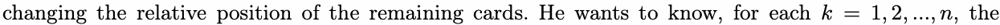

maximum damage he can deal to the Warrior.

## Input

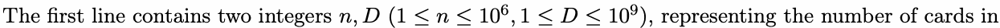

Little Q’s deck and the Warrior’s armor.

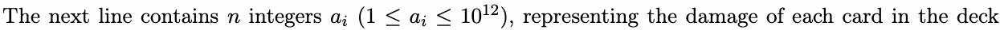

from top to bottom.

## Output

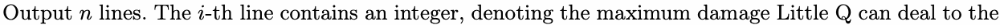

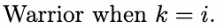

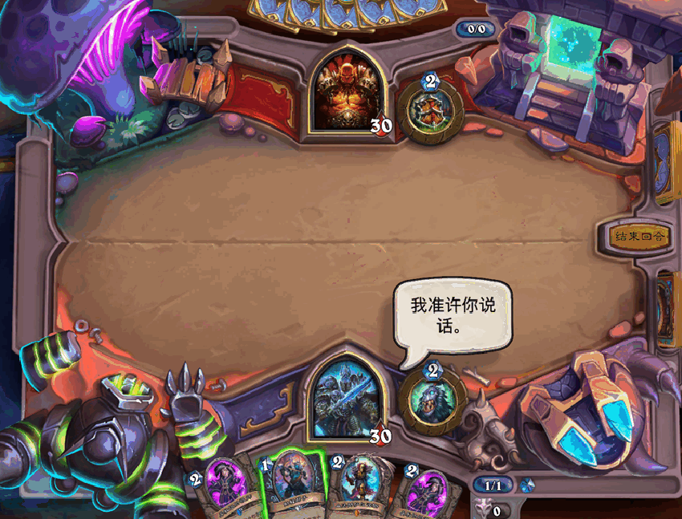

## Example

### 样例输入

```text
5 5
2 1 5 4 3
```

### 样例输出

```text
0
4
7
9
10
```

## Note

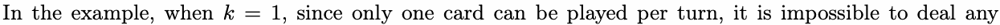

damage to the Warrior anyway.

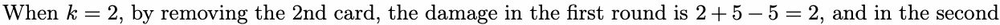

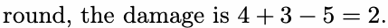

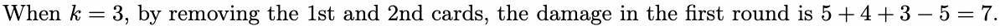

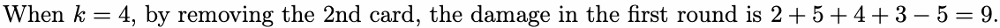

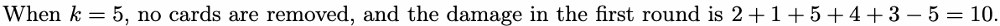
