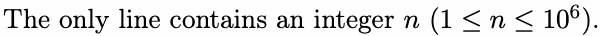
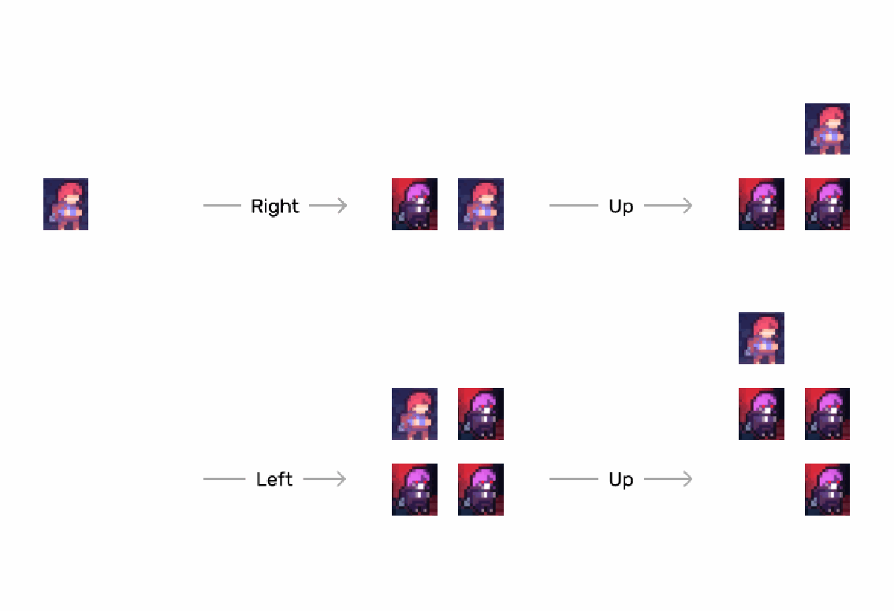

# F. Pac-Girl

Input file: standard input

Output file: standard output

Time limit: 1 second

Memory limit: 256 megabytes

Little Q is playing Celeste, controlling Madeline to escape from three Badelines. Madeline is initially

placed at the origin, and for every moment, Little Q can move Madeline by one unit in one of the four

directions: up, down, left, or right (we do not consider gravity, meaning Madeline will not naturally fall

down).

Three Badelines will be generated at the origin at the first 3 moments and follow the same trace as

Madeline (in other words, Badelines will appear in the same position as Madeline’s last three positions).

For every moment, Badelines will move or generate after Madeline’s move. Madeline cannot move to a

position where Badelines are located.

The picture shows how Badelines generate and move during the first 4 moments.

Little Q wants to know how many different operation plans there are such that Madeline will not collide


moves Madeline in a different direction.

Since the number of plans may be very large, Little Q only wants to know the answer modulo 1000000007

(i.e., the remainder when the answer is divided by 1 000 000 007).

## Input



## Output

Output a single integer representing the answer modulo 1 000 000 007.



## Examples

### 样例输入

```text
2
```

### 样例输出

```text
12
```

### 样例输入

```text
3
```

### 样例输出

```text
36
```

### 样例输入

```text
4
```

### 样例输出

```text
100
```

## Note


Madeline will collide with a Badeline that is in the position she occupied three moments ago.


