# G. Make SYSU Great Again 3.0 Alpha

Input file: standard input

Output file: standard output

Time limit: 1 second

Memory limit: 256 megabytes

As you all know, you are participating in the SYSUCPC (SYSU Constructive Problem Contest) qualifiers.

Undoubtedly, the Constructive Kingdom of Sun Yat-sen University is eager for you to tackle some

constructive problems.

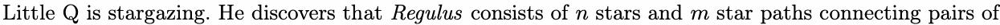

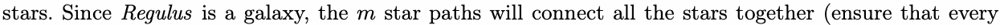

pair of stars can reach each other through bidirectional star paths) . However, the star paths can only

transmit light in one direction. Little Q does not know the direction of light transmission for each path,

and he only knows the brightness of each star.

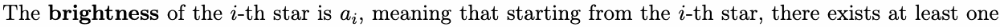

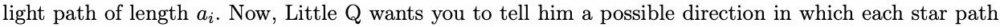

transmits light.

## Input

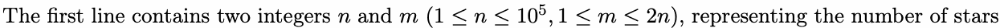

and star paths, respectively.

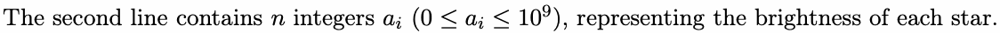

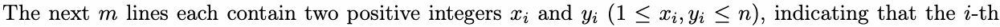

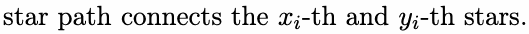

It is guaranteed that no star path connects the same star to itself, and no two star paths connect the

same pair of stars.

## Output

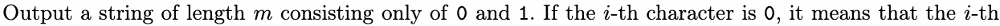

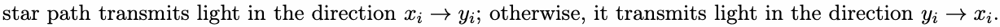

If there are more than one solutions, output any of them. If there is no solution, output “-1” (without

quotes).


## Examples

### 样例输入

```text
6 7
1 2 3 4 5 6
1 2
2 3
3 4
4 5
5 6
6 4
5 3
```

### 样例输出

```text
0000001
```

### 样例输入

```text
5 4
1 0 0 2 0
1 2
2 3
3 4
2 5
```

### 样例输出

```text
0110
```

### 样例输入

```text
5 4
0 2 0 2 3
4 2
5 4
5 1
3 4
```

### 样例输出

```text
-1
```

## Note

The picture below shows the Regulus given by the second example.

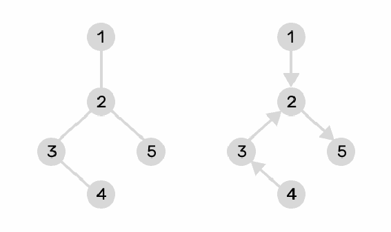
