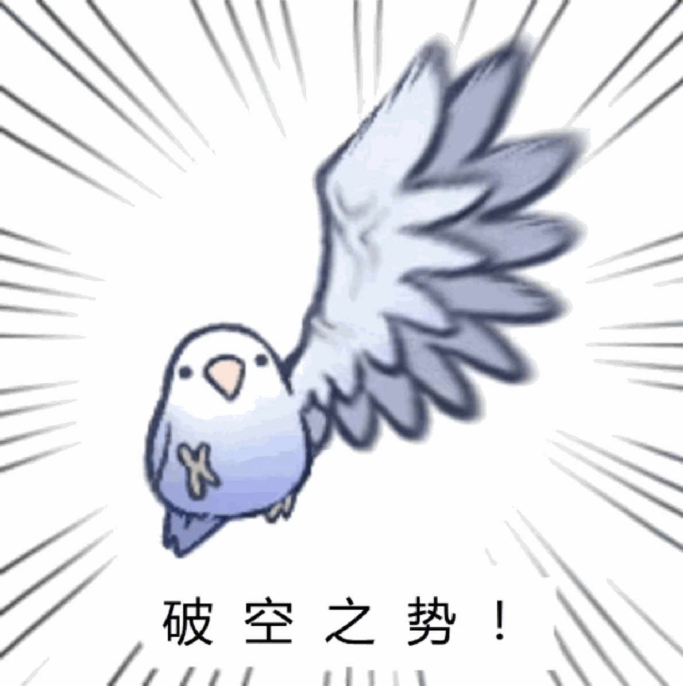
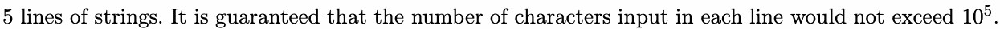

# A. Breakingsky and their common

Input file: standard input
Output file:

Output file: s s t t a a n n d d a a r r d d i o n u p t u p t ut
Time limit: 1 second

Time limit: s1tsaencdoanrdd

Memory limit: 256 megabytes

BreakingSky is a team consisting of three members, whose names are Pegasus,Hitass\_SY and Nekopass.

Hitass\_SY is always interested in the team’s signature. The signature of a team is defined as the longest
of all the members’ names of the team. For example, if a team consists of three

common subsequence of all the members’ names of the team. For example, if a team constihstesloofntghersete
members named , and , then the team’s signature is because it is the

cmoemmmbeorsnnsaumbesdeq P u s e u n sa c g e e, Hssati\_SY and Nssapoke, then the team’s signature is ssa because it is the
longest common subsequence of , and .

longest common sPusbusseaqgueenHcessoafti P \_ s S u Y sage, Hs N sa ss ti a \_ po S k Y e and Nssapoke.

Now Nekopass receives a 5-line message from Hitass\_SY. To figure out what information Hitass\_SY

intended to deliver, Nekopass first needs to delete all the spaces in the message. Then Nekopass will count

how many times the signature of BreakingSky appears in the message as a substring ignoring case in
and then . But Nekopass is busy playing Genpact Imshin, so he asks you to find

each line and then add them up. But Nekopass is busy playing Genpact Imshin, so higenaoskrsinygoucatosefinind



out the answer.

To prevent you from making mistakes, Nekopass reminds you that the names of BreakingSky’s three

members are Pegasus,Hitass\_SY and Nekopass, and a team’s signature is the longest common
of the team’s members’ names.

subsequence
PofegtahseutseHamita’sssm\_eSmYbers’ naNmeekso.p

A substring of a given sequence is a consecutive sequence of characters occurrences at least once in the
given string.

givseunbssttrriningg.

A subsequence of a given sequence is a sequence that can be derived from the given sequence by deleting
some or no elements without changing the order of the remaining elements.

somsuebosreqnuoeenlecmeents without changing the order of the remaining elements.

## Input



## Output

One integer, the answer to the input strings.

## Example

### 样例输入

```text
Breakingsky has three members.
They are pegasus , hitass_SY and nekopa
They are members in ACMM.
ACMM,YES!
I love SYSU , just as SYSU loves me.
```

### 样例输出

```text
3
ss.
```

## Note

To read a whole line in C++, you may need cin.getline()
