# B. Breakingsky and graph

Input file: standard input
Output file:

Output file: s s t t a a n n d d a a r r d d i o n u p t u p t ut
Time limit: 1 second

Time limit: s1tsaencdoanrdd

Memory limit: 256 megabytes

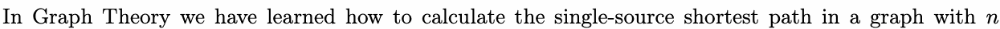

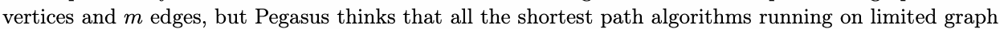

are useless, amnd “completely inextensible”.

What you said is right, but now I’m creating an Open World Game. The game happens in a fantasy world

called “Sun Yeah Sand”, where selected people are granted “Sun’s Eye ”, and will guide the power of Sun.

In the end of the journey, you will finally discover the ultimate truth of “Sun Yeah Sand”......

“Sun Yeah Sand” is an infinite open world with infinite city. We can label the city in this world 0, 1, 2, 3,

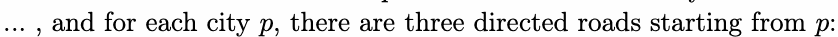

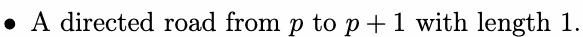

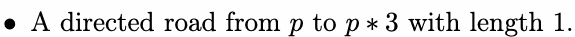

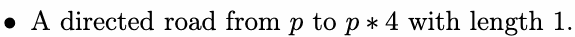

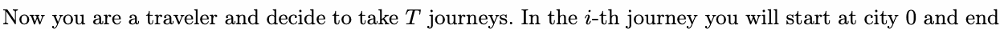

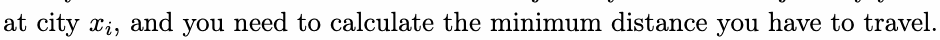

## Input

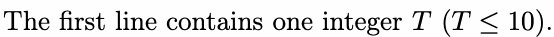

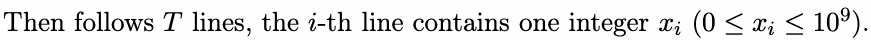

## Output

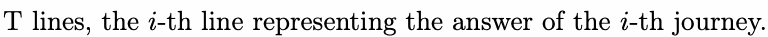

## Example

### 样例输入

```text
7
0
1
2
3
4
5
6
```

### 样例输出

```text
0
1
2
2
2
3
3
```
