# C. Breakingsky and space

Input file: standard input
Output file:

Output file: s s t t a a n n d d a a r r d d i o n u p t u p t ut
Time limit: 1 second

Time limit: s1tsaencdoanrdd

Memory limit: 256 megabytes

In the game Honor of Kings, there is a hero, Genghis Khan, who is almost forgotten by everyone. His

second skill Beast Trap can significantly increase the damage dealt by Genghis Khan if used properly. As

you can see, the trap’s trigger radius is far smaller than its damage radius, as shown in the picture, which

means that if someone triggers the trap, one may be attacked by the trap even if he is not in the trigger

radius of the trap.

Taking inspiration from life, Hitass\_ SY invents a trap sphere in three-dimensional space. The trap sphere

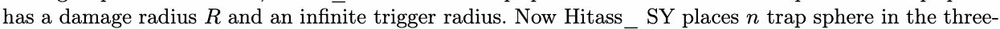

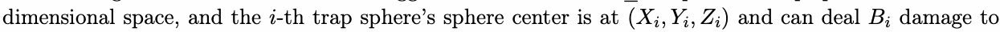

each one whose distance fromi the sphere center is no bigger than t(hXei,dYaim,Zagi)e radius once thBeitrap sphere

explodes. However, due to the difficulty of researching, all the trap spheres share the same damage radius

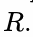

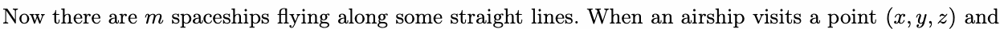

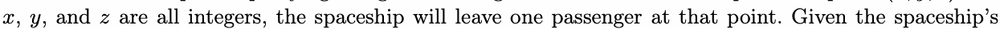

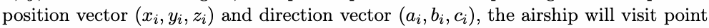

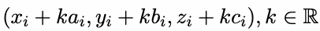

Once all the passengers have been left, all the traps will explode and deal damage to those passengers who

are in the damage radius. There are infinite passengers left in the three-dimensional space so Hitass\_SY

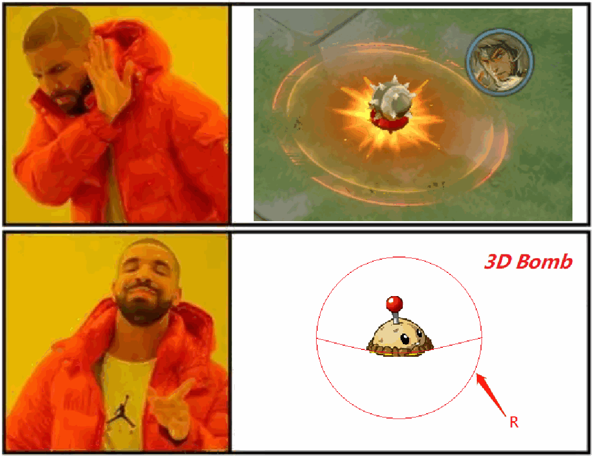

does not want to collect data about them. So now you have to help Hitass\_SY calculate the total damage

taken by all the passengers left by spaceships.

## Input

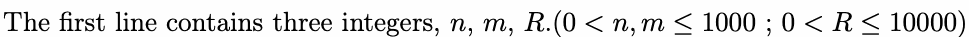

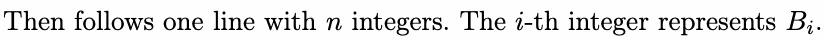

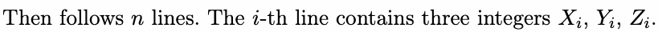

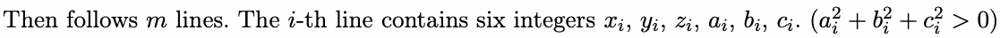

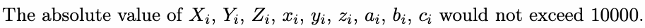

## Output

One integer, the total damage taken by all the passengers left by spaceships.

## Example

### 样例输入

```text
1 1 5000
1
0 0 0
0 0 0 1 0 0
```

### 样例输出

```text
10001
```
