# D. Breakingsky and star rail

Input file: standard input
Output file:

Output file: s s t t a a n n d d a a r r d d i o n u p t u p t ut
Time limit: 2 seconds

Time limit: s2tsaencdoanrdds

Memory limit: 256 megabytes

Nekopass, together with his friends, takes Astral Express across the Milky Way, along the journey of some

Aeon, towarding the end of the journey.

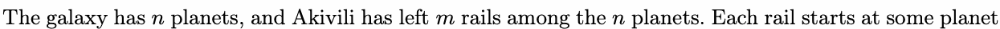

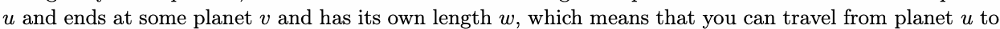

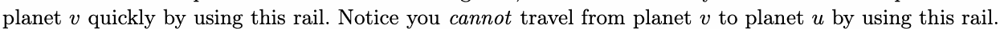

Howevevr, using rails is not free, because you shcoaunlndopt ay Pom-Pom, the covnductor, soume Stellar Jade for

using a rail, and as the number of rails you have used grows, the cost also grows. Specifically, if you use

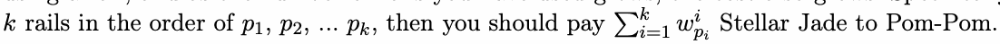

Nekopass is planning to spend as much as possible Stellar Jade for gacha, so he should save money when

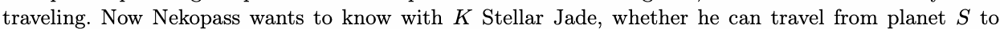

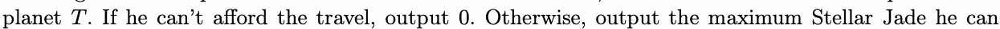

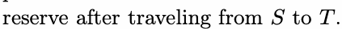

## Input

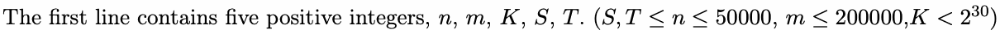

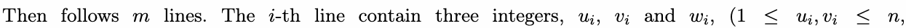

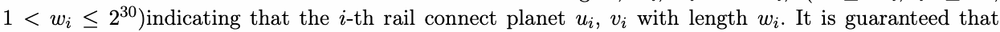

1the<rewaire≤no2 self-loops or multiple eidges.

## Output

One integer, denoting the answer.

## Example

### 样例输入

```text
4 4 64 1 4
1 2 4
2 4 3
1 3 2
3 4 4
```

### 样例输出

```text
51
```

## Note

In the example,

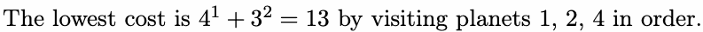

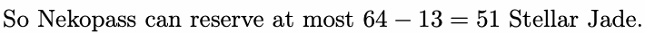

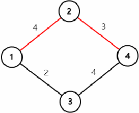
