# E. Breakingsky and ping_fan

Input file: standard input
Output file:

Output file: s s t t a a n n d d a a r r d d i o n u p t u p t ut
Time limit: 1 second

Time limit: s1tsaencdoanrdd

Memory limit: 256 megabytes

Ping\_fan is a good friend of BreakingSky. He loves playing a music game called "Project phigarcea:

chunimaiDX". The level of a player can be measured by a positive integer known as potential (ptt for
short).

short).

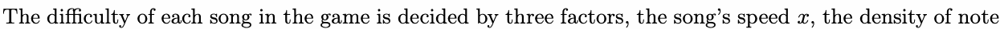

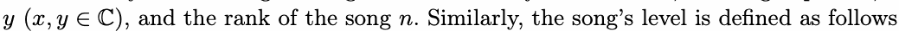

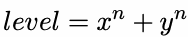

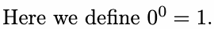

To enhance his strength in playing music games, Ping\_fan will choose a song whose level is the same as

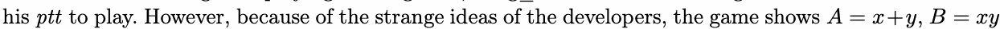

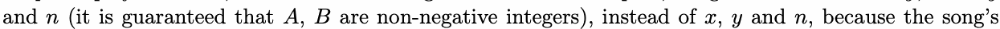

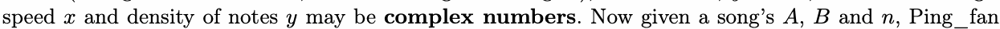

wants xyou to tell with how muych ptt wilclohme cphleoxosenuthmisbseornsg.

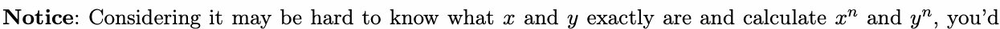

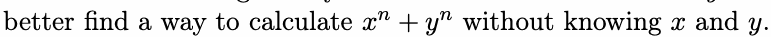

## Input

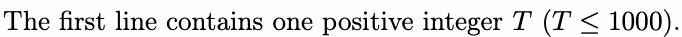

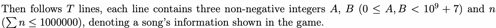

## Output

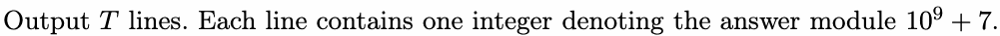

## Example

### 样例输入

```text
3
2 2 2
1 1 1
0 0 0
```

### 样例输出

```text
0
1
2
```

## Note

In the example,

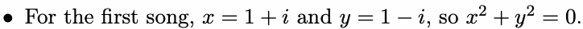

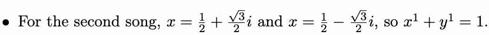

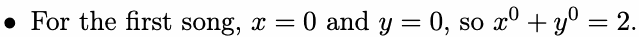
