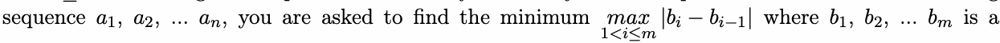
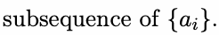
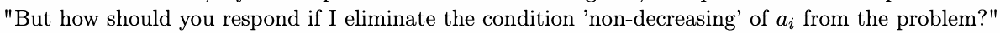
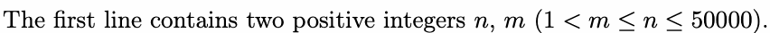
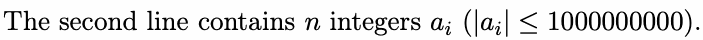

# F. Breakingsky and sequences

Input file: standard input
Output file:

Output file: s s t t a a n n d d a a r r d d i o n u p t u p t ut
Time limit: 2 seconds

Time limit: s2tsaencdoanrdds

Memory limit: 256 megabytes

Hitass\_SY is solving classic problems these days. One day he saw a problem: Given a non-decreasing





"You are formidable, my lordship. I have to admit. said Pegasus, who plans to make the problem harder,



Hitass\_SY quickly finds that he can’t solve the problem on his own. So will warm-heated you help

Hitass\_SY solve this problem?

## Input





## Output

One integer, denoting the minimum answer you get.

## Example

### 样例输入

```text
3 3
5 2 7
```

### 样例输出

```text
5
```
