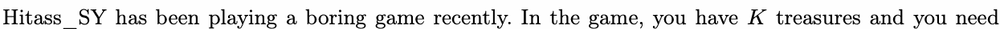
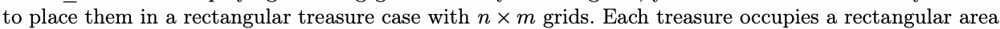
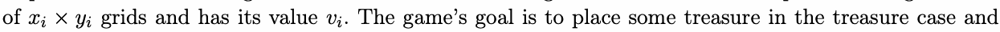
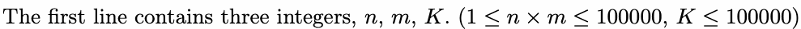
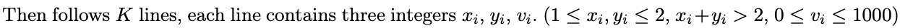

# G. Breakingsky and warehouse

Input file: standard input
Output file:

Output file: s s t t a a n n d d a a r r d d i o n u p t u p t ut
Time limit: 1 second

Time limit: s1tsaencdoanrdd

Memory limit: 256 megabytes

This problem used to be another problem but under someone’s demand, it was replaced by this problem

now.







maxxiim×izyei the sum of the treasurevsi’ value in the treasure case. You may NOT place a treasure in the
treasure case after rotating it at any non-zero angle. Also, two treasures may share a common grid.

treasure case after rotating it at any non-zero angle. Also, two treasures maNy N OT OT share a common grid.

Now Hitass\_SY wants to know what is the maximum value he can get.

## Input





## Output

One non-negative integer, representing the answer.

## Example

### 样例输入

```text
2 3 3
2 2 10
1 2 2
2 1 3
```

### 样例输出

```text
13
```


