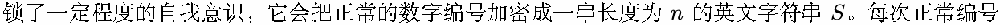
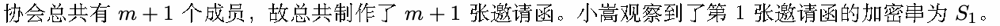
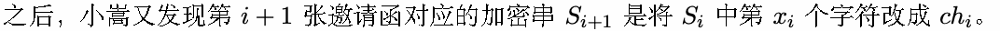
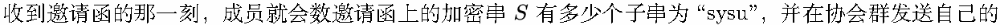
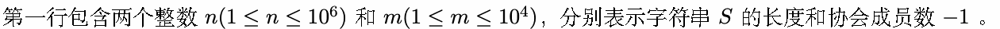
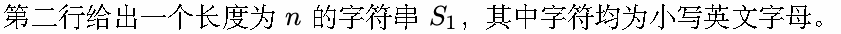
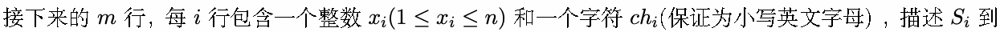
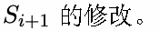
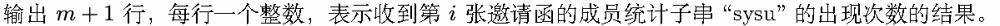

# B. 寻觅

输入文件: standard input

输出文件: standard output

时间限制: 1 second

空间限制: 128 megabytes

慧青学者协会 (Savvy Young Scholar Union) 聚集了一群朝气蓬勃的青年学者。他们经常举行集会讨论前

沿理论问题。下周二是协会的创办 001 周年纪念日，为此协会理事会决定举办盛大的庆典。

理事长分配给秘书小嵩一个任务：给协会成员发送庆典的邀请函。在编写好得体的文书和导入协会名录

后，打印机被小嵩一键启动，一张张邀请函被制作出来。然而，不同寻常的是，慧青学者协会的打印机解



加 1，对这个字符串的影响是修改某个特定位置的字符 (当然也有可能全串维持不变)。





收到邀请函的成员十分兴奋，聪明的他/她一下子就注意到了那串神奇的字符串。出于强烈的集体认同感，



伟大发现。

聪明的你也是协会的一员，请试着预测所有人的消息吧。

## Input









## Output



## Example

### 样例输入

```text
6 5
sysusy
3 c
3 s
4 y
6 u
3 s
```

### 样例输出

```text
1
0
1
0
1
1
```

## Note

子串：串中任意个连续的字符组成的子序列称为该串的子串。
