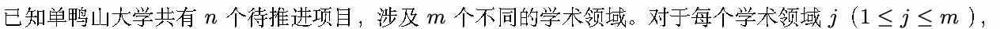
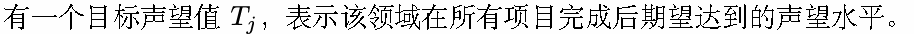
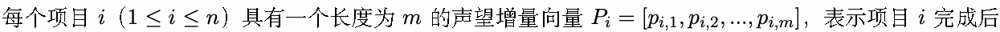
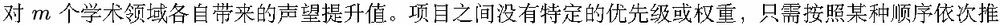
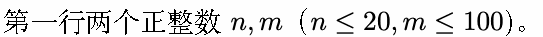
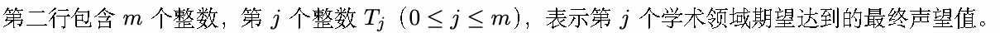
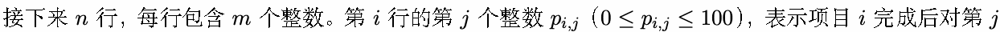

# C. 声望

输入文件: standard input

输出文件: standard output

时间限制: 1 second

空间限制: 256 megabytes

单鸭山大学在推进其发展战略中，规划了一系列重要项目，旨在提升学校在不同学术领域的国际声望。每

个项目完成后，会对特定领域带来直接的声望提升。目前，学校已经明确了所有项目完成后各学术领域最

终期望达到的声望值。









进，使得所有项目的声望增量之和能使所有学术领域达到其目标声望值。

现在要求计算在满足所有学术领域最终声望目标的前提下（要严格等于目标声望，不能多，也不能少），

单鸭山大学可以采用多少种不同的项目推进方案。请注意，两种方案相同当且仅当两个方案推进相同的

项目。

## Input







个学术领域带来的声望提升值。

## Output

输出一个整数，表示单鸭山大学在满足所有学术领域声望目标的前提下，可采用的不同项目推进方案数。

## Example

### 样例输入

```text
3 3
5 2 3
1 2 1
4 0 2
5 2 3
```

### 样例输出

```text
2
```

## Note

一种方案是推进项目 1,2; 另一种方案是推进项目 3. 两种方案都恰好使得最终的声望向量为 [5, 2, 3]
