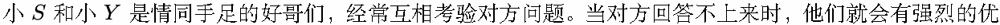
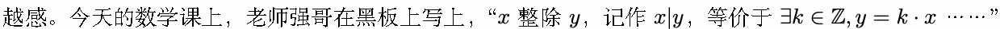
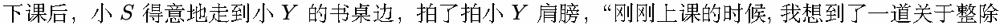
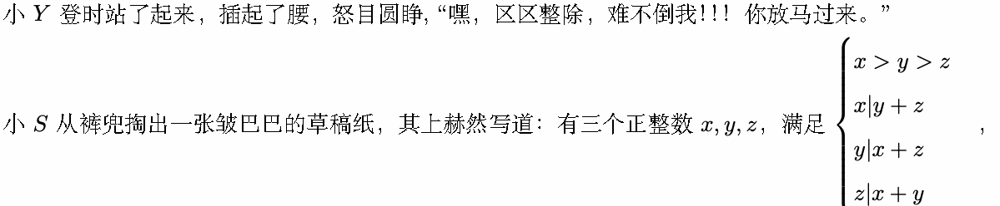
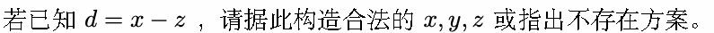
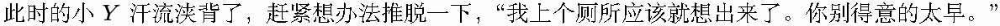
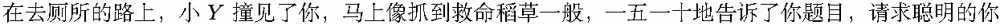
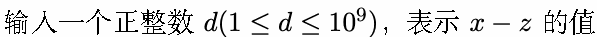
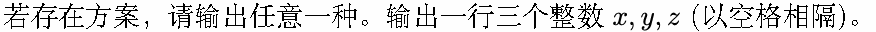

# D. 区区整除

输入文件: standard input

输出文件: standard output

时间限制: 1 second

空间限制: 16 megabytes







的题，你肯定不会做。”









的帮助。

## Input



## Output



若无解，输出 “Impossible”(不包含引号)。

## Examples

### 样例输入

```text
3
```

### 样例输出

```text
Impossible
```

### 样例输入

```text
4
```

### 样例输出

```text
6 4 2
```
