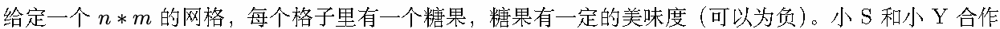
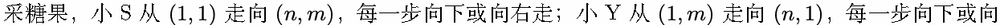
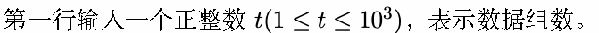
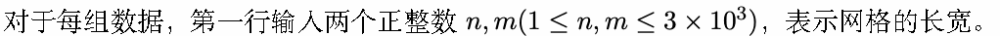
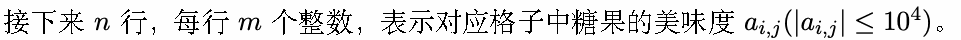
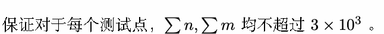

# E. 采糖果

输入文件: standard input

输出文件: standard output

时间限制: 4 seconds

空间限制: 512 megabytes

小 S 和小 Y 正在参加 SYSU（Super Yummy -Suger Union-）的百年庆典。在庆典上，有这么一个活动：





左走。每个格子里面的糖果只能被采一次，而小 S 和小 Y 希望能获得最大的美味度总和。

然而小 S 和小 Y 只是两个喜欢吃糖果的女孩子，于是她们找到了博学、审问、慎思、明辨、笃行的你，

你能想办法帮她们夺得头奖吗？

## Input









## Output

对于每组数据，输出一行一个整数表示答案。

## Example

### 样例输入

```text
2
3 3
1 2 3
1 2 3
1 2 3
3 3
-1 -2 -3
-1 -2 -3
-1 -2 -3
```

### 样例输出

```text
18
-13
```
