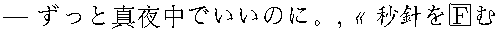
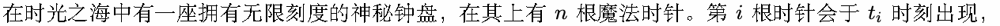
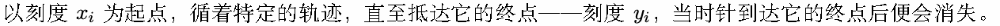
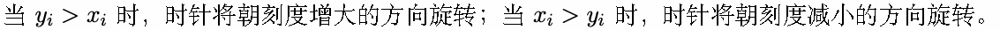
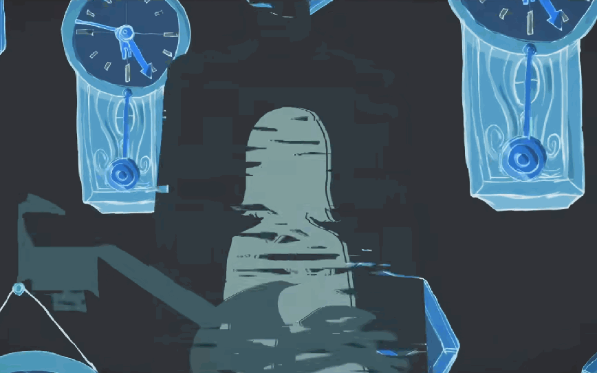
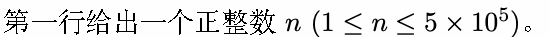
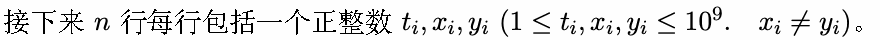

# G. 咬合秒针

输入文件: standard input

输出文件: standard output

时间限制: 3 seconds

空间限制: 256 megabytes

沉入灰烬 咬合秒针

淌于白日梦中

渐渐支离破碎

但是毁坏不了

也不允许我停住

只能不明「就里」地继续前进了

互相理解的轮回里即使一件都不存在

见了面「对不起。」这种的也不要丢还给我



»







所有时针的运动都是严格按照每个时刻移动一个刻度的速度旋转，而在这个钟盘上，当两根方向相反的

时针在某一个时刻重合时，便会发生一次 咬合秒针。当然，时针在出现或者消失的时刻与方向相反的时

针重合也是可以发生 咬合秒针的。

此刻，你被赋予了一项使命：请计算，这钟盘之上将会发生多少次 咬合秒针。



## Input





## Output

输出一行包括一个整数，表示将会发生多少次 咬合秒针。

## Examples

### 样例输入

```text
5
1 1 5
2 9 1
3 1 10
2 6 2
2 1 4
```

### 样例输出

```text
4
```

### 样例输入

```text
3
1 1 7
4 8 9
5 9 5
```

### 样例输出

```text
2
```
