# H. 罗德岛战役

输入文件: standard input

输出文件: standard output

时间限制: 1 second

空间限制: 256 megabytes

一大批整合运动的领袖带领整合运动进军罗德岛

而你，doctor，作为罗德岛的战术指挥官，率领着干员们与整合运动的领袖对抗。

擒贼先擒王，所以如何击溃整合运动的领袖们显得极为重要。

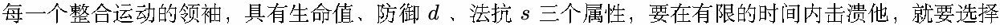

一些干员，使干员们在这段时间内造成的伤害 (实际造成的物理伤害 + 法术伤害 + 真实伤害) 大于等于

敌方领袖的生命值。

于是，你每次都会从未被选中的干员中选择一名加入编队，或者从已选中的干员中将一名干员移除编队，

并计算以目前编队内的干员，能否在有限时间内击杀这个敌方领袖。在将干员加入编队的时候，你会知道

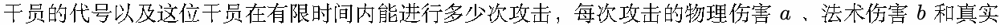

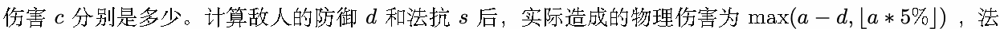

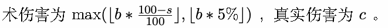

对于不同的敌方领袖，你会选择不同的编队。因此在结束一个敌方领袖的编队选择后，你会先清空编队，

再选择对抗下一个敌方领袖的编队。

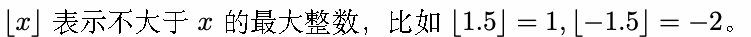

## Input

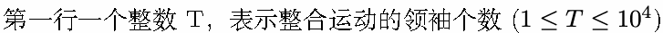

对于每一个敌方领袖，

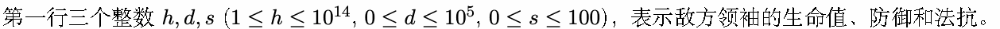

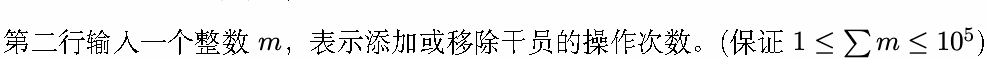

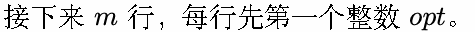

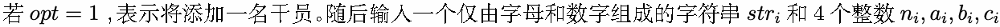

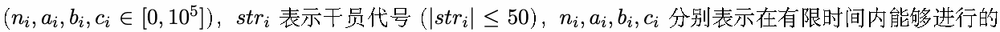

攻击次数，每次攻击的物理伤害、法术伤害和真实伤害。如果编队中已经有相应干员代号的干员，忽略这

次添加干员的操作直接输出答案。

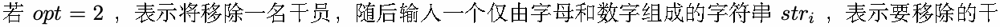

员的代号。若编队中没有以这个字符串为代号的干员，忽略这次移除干员的操作直接输出答案。

## Output

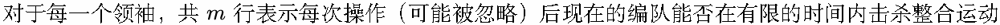

领袖。如果能，输出 Yes, 否则输出 No。(不区分大小写）

## Example

### 样例输入

```text
1
50000 3000 80
12
1 Amiya 20 0 1000 2000
1 Amiya 20 0 1000 2000
1 Degenbrecher 10 5000 0 0
1 KirinRYato 16 1265 633 0
2 Texas
2 Amiya
1 Eyjafjalla 27 0 1875 0
1 Amiya 20 0 1000 2000
2 Degenbrecher
2 Degenbrecher
2 Eyjafjalla
1 Eyjafjalla 27 0 1875 0
```

### 样例输出

```text
No
No
Yes
Yes
Yes
No
No
Yes
Yes
Yes
No
Yes
```
