# J. 回忆之树

输入文件: standard input

输出文件: standard output

时间限制: 1 second

空间限制: 256 megabytes

你知道吗？此段记忆，此篇关于光明与纷争的故事……

以一粒装满了感情的种子被埋进土中为始。

然后，在被珍视和被唾弃的回忆的共同滋养下，开始生根发芽。

再然后，它便茁壮成长，执拗地想去到更高的地方，一如这执拗的时间。

再然后呢，它就长成了一棵……BFS 树？？？

Arcaea 的世界是一张无向连通图。风云变幻，世界的法则不断更迭。回忆之树仍然挺立，但回忆之源却

已然模糊……

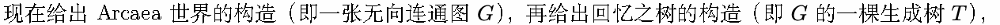

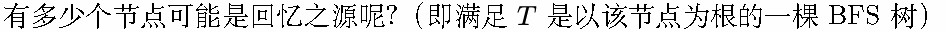

【名词解释】

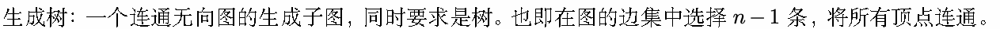

BFS：BFS 全称是 Breadth First Search，中文名是宽度优先搜索，也叫广度优先搜索。所谓宽度优先，

就是每次都尝试访问同一层的节点。如果同一层都访问完了，再访问下一层。

BFS 树：在 BFS 过程中，通过记录每个节点从哪个点访问而来，可以建立一个树结构，即为 BFS 树。

BFS 的起点即为树根。

## Input

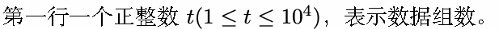

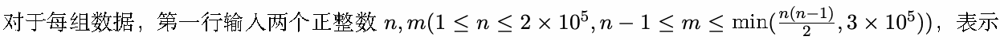

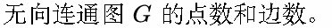

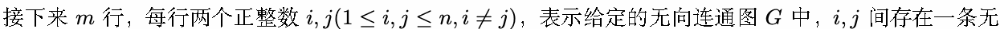

向边。

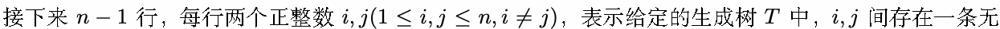

向边。

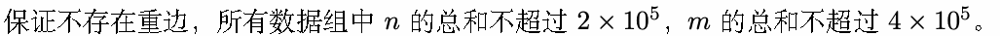

## Output

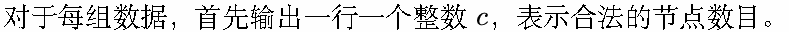

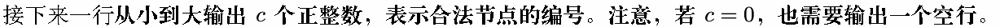

## Example

### 样例输入

```text
2
7 7
1 2
1 3
2 4
2 5
3 6
3 7
2 3
1 2
1 3
2 4
2 5
3 6
3 7
5 5
1 2
2 3
4 3
4 5
5 2
1 2
2 3
3 4
4 5
```

### 样例输出

```text
1
1
2
3 4
```
