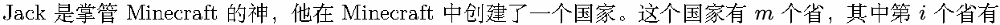
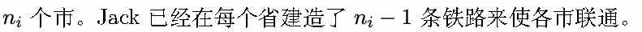
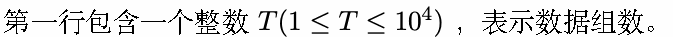
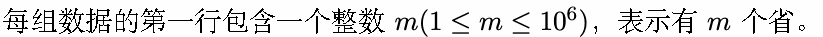
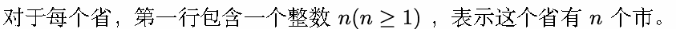
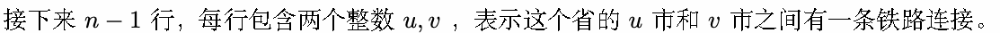
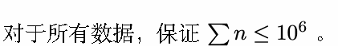

# L. 交通建造

输入文件: standard input

输出文件: standard output

时间限制: 2 seconds

空间限制: 256 megabytes






每条铁路连接两个来自不同省的市，并最终将各省各市通过铁路联通。

但是，这样建立交通也存在一个问题：从一个市到达另一个市，可能需要经过很多段不同的铁路，也就是

说要转很多次车。Jack 想知道，如果任意建造这些铁路，在建成各省之间的交通后，最远的两个市之间

的铁路个数的最大值和最小值。由于 Jack 在 Minecraft 中的计算机还在建造中，所以他把这个问题交给

了你。

## Input











## Output

对于每组数据，

第一行一个整数，表示在建成各省之间的交通后，最远的两个市之间的铁路个数的最大值。

第二行一个整数，表示在建成各省之间的交通后，最远的两个市之间的铁路个数的最小值。

## Example

### 样例输入

```text
2
2
10
1 4
7 8
10 6
2 6
6 5
3 6
6 8
9 6
4 6
6
1 3
5 6
1 2
5 4
3 4
3
8
5 3
6 8
4 6
1 6
4 2
7 1
3 6
3
1 3
3 2
4
1 3
4 2
2 1
```

### 样例输出

```text
10
6
11
5
```

## Note

对于样例的第一组数据，在 1 省的 7 市和 2 省的 2 市之间建造铁路能使最远的两个市之间的铁路个数取

得最大值，这样 1 省的 1 市和 2 省的 6 市就是距离最远的两个市，他们之间的铁路个数为 10。

在 1 省的 6 市和 2 省的 4 市之间建造铁路能使最远的两个市之间的铁路个数取得最小值，这样 1 省的 7

市和 2 省的 2 市就是距离最远的两个市，他们之间的铁路个数为 6。

注意：本题输入量较大, 请注意使用效率较高的读入方式。
