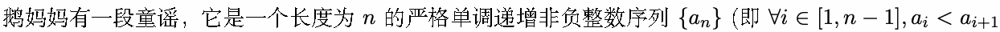
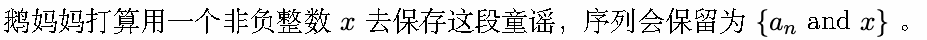
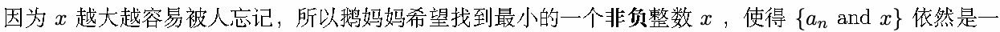
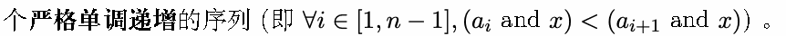
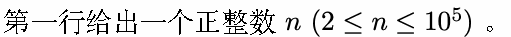
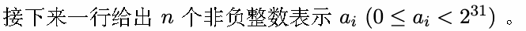
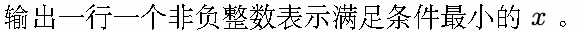
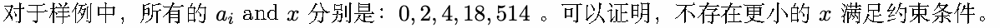

# N. 不为人知的位运算童谣

输入文件: standard input

输出文件: standard output

时间限制: 1 second

空间限制: 256 megabytes

言语都是过剩多余

这梦境也将持续下去

若要由我来谈论爱的话

那一切都已在这首歌中

谁也不知道的这个故事

似乎又不小心哼唱出来了



)。







其中 and 操作表示 按位与，如果你不了解定义可以阅读下列定义：

将两个整数作为二进制数，对二进制表示中的每一位逐一运算，只有对应的两个二进位都为 1 时，结果

位才为 1 。在 C++ 中, 可以使用 “&” 运算符进行按位与。

## Input





## Output



## Example

### 样例输入

```text
5
0 2 5 114 514
```

### 样例输出

```text
534
```

## Note


